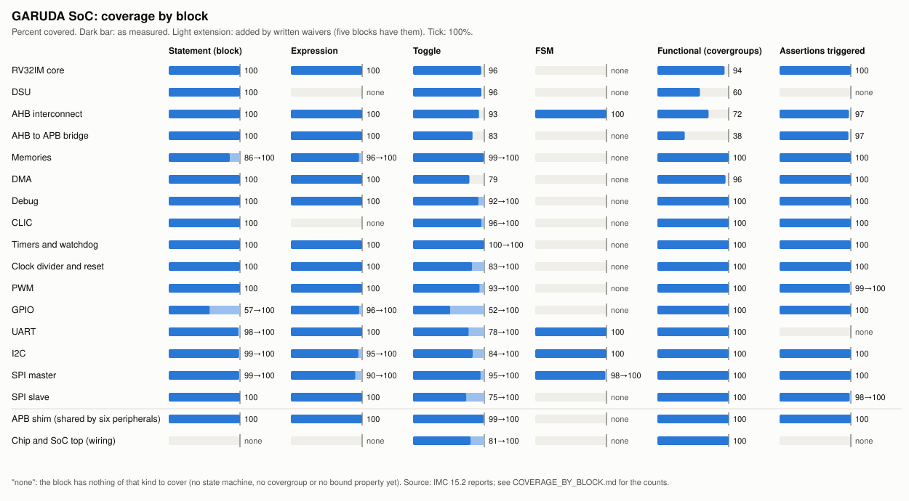

# GARUDA SoC: coverage by block

Written by `tools/gen/cov_chart.py` on 2026-11-21 from IMC 15.2 reports, tree `aaad3d3` plus uncommitted changes. No figure here is typed by hand: each is a covered/total pair IMC printed, added over the modules of the block. To make it again: `make cov_chart`.

## How to read it

- **Three sources.** The blocks that have a UVM environment of their own are measured on that environment's runs. The others are measured on the 415 directed runs of `flow/regress/garuda.vsif` merged together, counted per module. Both are shown as measured and, where exclusions are written in `flow/cov/`, after them. The five track-A blocks (core, DSU, AHB, bridge, DMA) are signed off on their own Verilator coverage flow with its own waivers; their rows show the Xcelium merge with no waiver and quote the Verilator verdict, which is the sign-off figure.
- **Statement, expression, toggle, FSM** are IMC's block, expression, toggle and FSM (states, transitions, arcs) metrics. **Functional** is covergroup bins. **Assertions triggered** counts bound properties and cover properties that finished at least once: a property that never triggered has checked nothing, however many tests passed.
- The sign-off bar (`flow/0_signoff_criteria.md`) is 100% functional and at least 95% code coverage with every hole waived in writing. A block is closed only when it meets it.

## Summary

| Block | Track | Measured on | Statement | Expression | Toggle | FSM | Functional | Assertions triggered | Waivers |
|---|---|---|---|---|---|---|---|---|---|
| RV32IM core | A | all directed tests, merged (no waivers applied here); **signed off on Verilator: `cov_core_report` PASS** | 100.0% (290/290) | 100.0% (85/85) | 95.7% (8551/8931) | none | 94.2% (1786/1895) | 100.0% (138/138) | 62, in `tb/core/cov/core_waivers.toml` (Verilator sign-off) |
| DSU | A | all directed tests, merged (no waivers applied here); **signed off on Verilator: `cov_dsu_report` PASS** | 100.0% (63/63) | none | 95.9% (3537/3689) | none | 59.7% (191/320) | none | 6, in `tb/dsu/cov/dsu_waivers.toml` (Verilator sign-off) |
| AHB interconnect | A | all directed tests, merged (no waivers applied here); **signed off on Verilator: `cov_ahb_report` PASS** | 100.0% (78/78) | 100.0% (9/9) | 92.5% (1300/1405) | 100.0% (7/7) | 71.8% (102/142) | 97.3% (36/37) | 6, in `tb/ahb/cov/ahb_waivers.toml` (Verilator sign-off) |
| AHB to APB bridge | A | all directed tests, merged (no waivers applied here); **signed off on Verilator: `cov_apb_report` PASS** | 100.0% (53/53) | 100.0% (6/6) | 83.4% (1074/1287) | none | 38.4% (53/138) | 96.7% (29/30) | 7, in `tb/ahb2apb/cov/ahb2apb_waivers.toml` (Verilator sign-off) |
| Memories | A | all directed tests, merged | 85.7% (60/70), after waivers 100.0% (60/60) | 95.7% (22/23), after waivers 100.0% (22/22) | 99.5% (968/973), after waivers 100.0% (968/968) | none | 100.0% (53/53) | 100.0% (21/21) | 16, in `flow/cov/mem_exclusions.tcl` |
| DMA | A | all directed tests, merged (no waivers applied here); **signed off on Verilator: `cov_dma_report` PASS** | 100.0% (148/148) | 100.0% (37/37) | 79.1% (2851/3606) | none | 95.6% (151/158) | 100.0% (54/54) | 24, in `tb/dma/cov/dma_waivers.toml` (Verilator sign-off) |
| Debug | A | all directed tests, merged | 100.0% (221/221) | 100.0% (49/49) | 91.7% (1414/1542), after waivers 100.0% (1414/1414) | none | 100.0% (80/80) | 100.0% (40/40) | 124, in `flow/cov/debug_exclusions.tcl` |
| CLIC | B | the block's UVM environment | 100.0% (25/25) | none | 95.8% (1177/1229), after waivers 100.0% (1177/1177) | none | 100.0% (429/429) | 100.0% (87/87) | 52, in `flow/cov/clic_exclusions.tcl` |
| Timers and watchdog | B | the block's UVM environment | 100.0% (68/68) | 100.0% (6/6) | 99.8% (1319/1321), after waivers 100.0% (1319/1319) | none | 100.0% (145/145) | 100.0% (36/36) | 3, in `flow/cov/timers_exclusions.tcl` |
| Clock divider and reset | B | the block's UVM environment | 100.0% (73/73) | 100.0% (16/16) | 82.7% (249/301), after waivers 100.0% (249/249) | none | 100.0% (106/106) | 100.0% (43/43) | 55, in `flow/cov/crg_exclusions.tcl` |
| PWM | B | the block's UVM environment | 100.0% (86/86) | 100.0% (18/18) | 93.3% (526/564), after waivers 100.0% (526/526) | none | 100.0% (275/275) | 98.7% (76/77), after waivers 100.0% (76/76) | 40, in `flow/cov/pwm_exclusions.tcl` |
| GPIO | B | the block's UVM environment | 57.4% (147/256), after waivers 100.0% (147/147) | 95.8% (23/24), after waivers 100.0% (19/19) | 52.0% (584/1122), after waivers 100.0% (584/584) | none | 100.0% (214/214) | 100.0% (36/36) | 649, in `flow/cov/gpio_exclusions.tcl` |
| UART | B | the block's UVM environment | 97.6% (245/251), after waivers 100.0% (245/245) | 100.0% (44/44) | 78.0% (679/871), after waivers 100.0% (679/679) | 100.0% (28/28) | 100.0% (211/211) | none | 198, in `flow/cov/uart_exclusions.tcl` |
| I2C | B | the block's UVM environment | 98.7% (230/233), after waivers 100.0% (230/230) | 94.7% (18/19), after waivers 100.0% (15/15) | 83.6% (624/746), after waivers 100.0% (624/624) | 100.0% (56/56) | 100.0% (222/222) | 100.0% (68/68) | 128, in `flow/cov/i2c_exclusions.tcl` |
| SPI master | B | all directed tests, merged | 98.8% (242/245), after waivers 100.0% (242/242) | 90.3% (65/72), after waivers 100.0% (65/65) | 94.7% (1820/1921), after waivers 100.0% (1820/1820) | 98.1% (53/54), after waivers 100.0% (53/53) | 100.0% (68/68) | 100.0% (14/14) | 106, in `flow/cov/spim_exclusions.tcl` |
| SPI slave | B | the block's UVM environment | 100.0% (99/99) | 100.0% (24/24) | 74.6% (419/562), after waivers 100.0% (419/419) | none | 100.0% (146/146) | 98.1% (53/54), after waivers 100.0% (53/53) | 147, in `flow/cov/spis_exclusions.tcl` |
| APB shim (shared by six peripherals) | B | all directed tests, merged | 100.0% (14/14) | 100.0% (6/6) | 99.3% (138/139), after waivers 100.0% (138/138) | none | 100.0% (35/35) | 100.0% (19/19) | 1, in `flow/cov/shim_exclusions.tcl` |
| Chip and SoC top (wiring) | B | all directed tests, merged | none | none | 80.7% (2039/2527), after waivers 100.0% (2039/2039) | none | 100.0% (57/57) | none | 488, in `flow/cov/top_exclusions.tcl` |

Over the sixteen blocks, counting items (waived items removed for the five blocks that have waivers): statement 100.0% (2128/2128), expression 100.0% (415/415), toggle 94.4% (27092/28697), FSM 100.0% (144/144); all four together 94.9% (29779/31384).

## Block by block

### RV32IM core

Plan: `tb/core/GARUDA_CORE_vplan.csv` (41 features, 70 checks and coverage items). Track A.

Measured on all directed tests merged, per module. No waiver applied.

| Module | Statement | Expression | Toggle | FSM |
|---|---|---|---|---|
| `garuda_core_top` | 100.0% (9/9) | none | 96.3% (1705/1770) | none |
| `core_clk_gate` | 100.0% (3/3) | none | 100.0% (5/5) | none |
| `if_stage_top` | none | none | 86.2% (269/312) | none |
| `garuda_pc_gen` | 100.0% (7/7) | none | 98.5% (67/68) | none |
| `iport_master` | 100.0% (19/19) | 100.0% (18/18) | 83.7% (257/307) | none |
| `prefetch_buf` | 100.0% (15/15) | none | 97.3% (143/147) | none |
| `if_id` | 100.0% (7/7) | none | 97.1% (133/137) | none |
| `id_stage` | none | none | 98.8% (554/561) | none |
| `decode_control` | 100.0% (60/60) | 100.0% (15/15) | 100.0% (110/110) | none |
| `imm_gen` | 100.0% (8/8) | none | 86.7% (280/323) | none |
| `regfile` | 100.0% (3/3) | 100.0% (11/11) | 100.0% (177/177) | none |
| `branch_predict` | none | none | 96.1% (221/230) | none |
| `hazard_fwd_unit` | none | none | 100.0% (17/17) | none |
| `id_ex` | 100.0% (7/7) | none | 99.4% (467/470) | none |
| `forward_unit` | none | 100.0% (12/12) | 100.0% (28/28) | none |
| `ex_stage` | 100.0% (4/4) | 100.0% (3/3) | 99.6% (900/904) | none |
| `alu_unit` | 100.0% (13/13) | none | 100.0% (139/139) | none |
| `mul32` | none | none | 100.0% (231/231) | none |
| `branch_unit` | 100.0% (8/8) | 100.0% (6/6) | 98.2% (266/271) | none |
| `csr_rw` | none | none | 100.0% (70/70) | none |
| `ex_mem` | 100.0% (7/7) | none | 98.2% (217/221) | none |
| `mem_stage` | none | none | 98.0% (390/398) | none |
| `load_store_unit` | 100.0% (8/8) | none | 99.0% (101/102) | none |
| `dport_master` | 100.0% (14/14) | 100.0% (6/6) | 98.0% (145/148) | none |
| `load_formatter` | 100.0% (9/9) | none | 100.0% (96/96) | none |
| `mem_wb_reg` | 100.0% (5/5) | none | 100.0% (81/81) | none |
| `wb_stage` | none | none | 100.0% (76/76) | none |
| `csr_file` | 100.0% (77/77) | 100.0% (3/3) | 86.1% (632/734) | none |
| `clic_ctrl` | none | none | 96.5% (109/113) | none |
| `trap_ctrl` | 100.0% (7/7) | 100.0% (11/11) | 96.8% (512/529) | none |
| `pipe_ctrl` | none | none | 98.1% (153/156) | none |
| **whole block** | 100.0% (290/290) | 100.0% (85/85) | 95.7% (8551/8931) | none |

Functional coverage: 94.2% (1786/1895).

| Covergroups of | Bins covered |
|---|---|
| garuda_cov (tb_boot: ISA and sanity programs; chip programs) | 100.0% (224/224) |
| garuda_core_cov_ext (tb_boot: ISA and sanity programs; chip programs) | 42.0% (76/181) |
| unit_alu | 100.0% (26/26) |
| unit_alu_unit | 100.0% (152/152) |
| unit_branch_predict | 100.0% (27/27) |
| unit_branch_unit | 100.0% (64/64) |
| unit_clic_ctrl | 100.0% (12/12) |
| unit_csr_rw | 100.0% (28/28) |
| unit_d_port_ahb_master | 100.0% (28/28) |
| unit_decode_control | 100.0% (213/213) |
| unit_dport_master | 100.0% (30/30) |
| unit_forward_unit | 100.0% (31/31) |
| unit_garuda_if_stage_top | 100.0% (22/22) |
| unit_garuda_iport_ahb_master | 100.0% (31/31) |
| unit_garuda_pc_gen | 100.0% (4/4) |
| unit_garuda_prefetch_buffer | 88.2% (30/34) |
| unit_hazard_forward_unit | 100.0% (105/105) |
| unit_hazard_fwd_unit | 100.0% (118/118) |
| unit_id_stage | 100.0% (154/154) |
| unit_if_stage_top | 100.0% (22/22) |
| unit_imm_gen | 100.0% (22/22) |
| unit_iport_master | 100.0% (31/31) |
| unit_load_formatter | 100.0% (39/39) |
| unit_load_store_unit | 100.0% (59/59) |
| unit_mem_stage | 100.0% (60/60) |
| unit_mem_wb_reg | 100.0% (17/17) |
| unit_mul32 | 100.0% (29/29) |
| unit_prefetch_buf | 100.0% (30/30) |
| unit_reg_file | 100.0% (102/102) |

Assertions: 100.0% (138/138) triggered.

**Sign-off:** this block is signed off on its own Verilator coverage flow, not on the figures above. `make -f flow/mk/track_a_run.mk cov_core_report` (`tools/cov/cov_report.py tb/core/cov/cov.toml`: at least 95% per code metric per module and 100% functional, after the 62 waivers in `tb/core/cov/core_waivers.toml`) printed, on this tree: `verdict: PASS  (0 below target, 0 waiver/input error(s))`. The figures above are the Xcelium merge with no waiver applied; a hole there is either waived in the Verilator flow or hit by a Verilator-only run.

### DSU

Plan: `tb/dsu/GARUDA_DSU_vplan.csv` (28 features, 44 checks and coverage items). Track A.

Measured on all directed tests merged, per module. No waiver applied.

| Module | Statement | Expression | Toggle | FSM |
|---|---|---|---|---|
| `dsu_top` | 100.0% (5/5) | none | 100.0% (573/573) | none |
| `dsu_decoder` | none | none | 100.0% (129/129) | none |
| `saturation_unit` | 100.0% (5/5) | none | 54.9% (117/213) | none |
| `mac_cluster` | 100.0% (5/5) | none | 100.0% (479/479) | none |
| `mac_unit` | 100.0% (24/24) | none | 95.8% (1150/1201) | none |
| `operand_router` | 100.0% (5/5) | none | 98.8% (161/163) | none |
| `mult_16x16` | none | none | 100.0% (64/64) | none |
| `csa_3to2` | none | none | 99.2% (243/245) | none |
| `kogge_stone_49` | none | none | 99.3% (146/147) | none |
| `barrel_shifter` | none | none | 100.0% (199/199) | none |
| `readback_mux` | none | none | 100.0% (112/112) | none |
| `result_selector` | 100.0% (5/5) | none | 100.0% (130/130) | none |
| `overflow_flag` | 100.0% (7/7) | none | 100.0% (9/9) | none |
| `dsu_stall` | 100.0% (7/7) | none | 100.0% (25/25) | none |
| **whole block** | 100.0% (63/63) | none | 95.9% (3537/3689) | none |

Functional coverage: 59.7% (191/320).

| Covergroups of | Bins covered |
|---|---|
| dsu_cov | 59.7% (191/320) |

Assertions: no property is bound to this block yet.

**Sign-off:** this block is signed off on its own Verilator coverage flow, not on the figures above. `make -f flow/mk/track_a_run.mk cov_dsu_report` (`tools/cov/cov_report.py tb/dsu/cov/cov.toml`: at least 95% per code metric per module and 100% functional, after the 6 waivers in `tb/dsu/cov/dsu_waivers.toml`) printed, on this tree: `verdict: PASS  (0 below target, 0 waiver/input error(s))`. The figures above are the Xcelium merge with no waiver applied; a hole there is either waived in the Verilator flow or hit by a Verilator-only run.

### AHB interconnect

Plan: `tb/ahb/GARUDA_AHB_vplan.csv` (24 features, 45 checks and coverage items). Track A.

Measured on all directed tests merged, per module. No waiver applied.

| Module | Statement | Expression | Toggle | FSM |
|---|---|---|---|---|
| `ahb_interconnect` | none | none | 92.6% (650/702) | none |
| `ahb_arbiter` | 100.0% (13/13) | 100.0% (3/3) | 90.0% (27/30) | none |
| `ahb_master_mux` | 100.0% (13/13) | 100.0% (3/3) | 86.2% (306/355) | none |
| `ahb_decoder` | 100.0% (6/6) | none | 100.0% (9/9) | none |
| `ahb_dflt_slave` | 100.0% (10/10) | none | 100.0% (12/12) | 100.0% (7/7) |
| `ahb_slave_mux` | 100.0% (29/29) | none | 100.0% (186/186) | none |
| `ahb_master_port` | 100.0% (7/7) | 100.0% (3/3) | 99.1% (110/111) | none |
| **whole block** | 100.0% (78/78) | 100.0% (9/9) | 92.5% (1300/1405) | 100.0% (7/7) |

Functional coverage: 71.8% (102/142).

| Covergroups of | Bins covered |
|---|---|
| ahb_interconnect_cov | 71.8% (102/142) |

Assertions: 97.3% (36/37) triggered. Never triggered: `c_all_request`.

**Sign-off:** this block is signed off on its own Verilator coverage flow, not on the figures above. `make -f flow/mk/track_a_run.mk cov_ahb_report` (`tools/cov/cov_report.py tb/ahb/cov/cov.toml`: at least 95% per code metric per module and 100% functional, after the 6 waivers in `tb/ahb/cov/ahb_waivers.toml`) printed, on this tree: `verdict: PASS  (0 below target, 0 waiver/input error(s))`. The figures above are the Xcelium merge with no waiver applied; a hole there is either waived in the Verilator flow or hit by a Verilator-only run.

### AHB to APB bridge

Plan: `tb/ahb2apb/GARUDA_AHB2APB_vplan.csv` (30 features, 58 checks and coverage items). Track A.

Measured on all directed tests merged, per module. No waiver applied.

| Module | Statement | Expression | Toggle | FSM |
|---|---|---|---|---|
| `ahb2apb_bridge` | 100.0% (25/25) | 100.0% (6/6) | 85.0% (603/709) | none |
| `ahb2apb_apb_fsm` | 100.0% (28/28) | none | 95.2% (118/124) | none |
| `ahb2apb_fabric` | none | none | 77.8% (353/454) | none |
| **whole block** | 100.0% (53/53) | 100.0% (6/6) | 83.4% (1074/1287) | none |

Functional coverage: 38.4% (53/138).

| Covergroups of | Bins covered |
|---|---|
| ahb2apb_bridge_cov | 38.4% (53/138) |

Assertions: 96.7% (29/30) triggered. Never triggered: `c_in_reset`.

**Sign-off:** this block is signed off on its own Verilator coverage flow, not on the figures above. `make -f flow/mk/track_a_run.mk cov_apb_report` (`tools/cov/cov_report.py tb/ahb2apb/cov/cov.toml`: at least 95% per code metric per module and 100% functional, after the 7 waivers in `tb/ahb2apb/cov/ahb2apb_waivers.toml`) printed, on this tree: `verdict: PASS  (0 below target, 0 waiver/input error(s))`. The figures above are the Xcelium merge with no waiver applied; a hole there is either waived in the Verilator flow or hit by a Verilator-only run.

### Memories

Plan: `tb/mem/GARUDA_MEM_vplan.csv` (28 features, 40 checks and coverage items). Track A.

Measured on the UVM environment (0 runs: register test, directed test, random seeds), DUT instance only.

| Metric | As measured | After waivers | Items waived |
|---|---|---|---|
| Block | 85.7% (60/70) | 100.0% (60/60) | 10 |
| Expression | 95.7% (22/23) | 100.0% (22/22) | 1 |
| Toggle | 99.5% (968/973) | 100.0% (968/968) | 5 |
| Assertion | 100.0% (21/21) | 100.0% (21/21) | 0 |
| Functional (covergroup bins) | 100.0% (53/53) | 100.0% (53/53) | 0 |

**Exclusions and their justifications** (`flow/cov/mem_exclusions.tcl`, 16 lines):

| Metric | Where | Items | Justification |
|---|---|---|---|
| block | `bootrom_top` | 1: `1` | bd_load_hex call (bootrom_top.sv:63) inside ifndef SYNTHESIS: a bench backdoor preload, not hardware |
| block | `isram_top` | 1: `4` | bd_load_hex call (isram_top.sv:79) inside ifndef SYNTHESIS: a bench backdoor preload, not hardware |
| block | `dsram_top` | 1: `8` | backdoor bd_write to bank 1 (dsram_top.sv:89) inside ifndef SYNTHESIS: bench code, not hardware |
| block | `dsram_top` | 1: `9` | backdoor bd_write to bank 2 (dsram_top.sv:90) inside ifndef SYNTHESIS: bench code, not hardware |
| block | `dsram_top` | 1: `13` | backdoor bd_read of bank 0 (dsram_top.sv:103) inside ifndef SYNTHESIS: bench code, not hardware |
| block | `dsram_top` | 1: `14` | backdoor bd_read of bank 1 (dsram_top.sv:104) inside ifndef SYNTHESIS: bench code, not hardware |
| block | `dsram_top` | 1: `15` | backdoor bd_read of bank 2 (dsram_top.sv:105) inside ifndef SYNTHESIS: bench code, not hardware |
| block | `sram_wrapper` | 1: `21` | readmemh preload (sram_wrapper.sv:118-120) inside ifndef SYNTHESIS: bench code, not hardware |
| block | `ahb_mem_slave_if` | 1: `23` | simulation-only self-check (ahb_mem_slave_if.sv:198-203, ifndef SYNTHESIS) that prints on a write-buffer overflow: never firing is the passing result |
| expression | `ahb_mem_slave_if` | 1: `2.1.1` | the condition of the same simulation-only overflow self-check (ahb_mem_slave_if.sv:200): the row park_wr AND wb_v is a write data phase with the buffer full, which a_wbuf_empty_in_write_dp proves never happens (JasperGold PROVEN, flow/formal/mem/mem_fpv.result.txt) |
| block | `sram_wrapper` | 1: `17` | the ROM-write path (sram_wrapper.sv:101, we with IS_ROM = 1): the boot ROM's interface refuses every write (WRITABLE = 0, AHB ERROR), so its array never sees we |
| toggle | `bootrom_top` | 1: `we` | the boot ROM's array write enable is constant 0: its interface refuses every write (WRITABLE = 0) |
| toggle | `ahb_mem_slave_if` | 1: `hsize_i` | the AHB is 32 bits wide: HSIZE is at most word, so bit 2 is 0 |
| toggle | `bootrom_top` | 1: `hsize_i` | the AHB is 32 bits wide: HSIZE is at most word, so bit 2 is 0 |
| toggle | `isram_top` | 1: `hsize_i` | the AHB is 32 bits wide: HSIZE is at most word, so bit 2 is 0 |
| toggle | `dsram_top` | 1: `hsize_i` | the AHB is 32 bits wide: HSIZE is at most word, so bit 2 is 0 |

### DMA

Plan: `tb/dma/GARUDA_DMA_vplan.csv` (41 features, 64 checks and coverage items). Track A.

Measured on all directed tests merged, per module. No waiver applied.

| Module | Statement | Expression | Toggle | FSM |
|---|---|---|---|---|
| `dma_top` | none | none | 72.4% (929/1283) | none |
| `dma_apb_slave` | 100.0% (8/8) | 100.0% (3/3) | 69.2% (823/1189) | none |
| `dma_chan` | 100.0% (76/76) | 100.0% (12/12) | 90.7% (283/312) | none |
| `dma_arbiter` | 100.0% (6/6) | 100.0% (4/4) | 100.0% (10/10) | none |
| `dma_engine` | 100.0% (55/55) | 100.0% (18/18) | 99.3% (806/812) | none |
| `dma_engine, generate ack2_T_F` | 100.0% (3/3) | none | none | none |
| **whole block** | 100.0% (148/148) | 100.0% (37/37) | 79.1% (2851/3606) | none |

Functional coverage: 95.6% (151/158).

| Covergroups of | Bins covered |
|---|---|
| dma_cov | 95.6% (151/158) |

Assertions: 100.0% (54/54) triggered.

**Sign-off:** this block is signed off on its own Verilator coverage flow, not on the figures above. `make -f flow/mk/track_a_run.mk cov_dma_report` (`tools/cov/cov_report.py tb/dma/cov/cov.toml`: at least 95% per code metric per module and 100% functional, after the 24 waivers in `tb/dma/cov/dma_waivers.toml`) printed, on this tree: `verdict: PASS  (0 below target, 0 waiver/input error(s))`. The figures above are the Xcelium merge with no waiver applied; a hole there is either waived in the Verilator flow or hit by a Verilator-only run.

### Debug

Plan: `tb/debug/GARUDA_DEBUG_vplan.csv` (36 features, 52 checks and coverage items). Track A.

Measured on the UVM environment (0 runs: register test, directed test, random seeds), DUT instance only.

| Metric | As measured | After waivers | Items waived |
|---|---|---|---|
| Block | 100.0% (221/221) | 100.0% (221/221) | 0 |
| Expression | 100.0% (49/49) | 100.0% (49/49) | 0 |
| Toggle | 91.7% (1414/1542) | 100.0% (1414/1414) | 128 |
| Assertion | 100.0% (40/40) | 100.0% (40/40) | 0 |
| Functional (covergroup bins) | 100.0% (80/80) | 100.0% (80/80) | 0 |

**Exclusions and their justifications** (`flow/cov/debug_exclusions.tcl`, 124 lines):

| Metric | Where | Items | Justification |
|---|---|---|---|
| toggle | `debug_dtm` | 20: `dtmcs` | dtmcs fields 31:12 are constants (zero, dmihardreset/dmireset read 0, idle = 5): debug_dtm.sv:60 |
| toggle | `debug_dtm` | 10: `dtmcs` | dtmcs abits = 7 and version = 1 are constants: debug_dtm.sv:60 |
| toggle | `debug_module` | 2: `dmcontrol` | dmcontrol haltreq/resumereq read 0 (write-only actions): constant in debug_module.sv:116 |
| toggle | `debug_module` | 27: `dmcontrol` | dmcontrol fields 28:2 (hasel, hartsel, set/clr resethaltreq, ackhavereset) are not implemented for one hart: constant 0, debug_module.sv:116 |
| toggle | `debug_module` | 20: `dmstatus` | dmstatus fields 31:12 are constants for one hart with no reset-halt (impebreak 0, allhavereset/anyhavereset/allresumeack 0): debug_module.sv:120 |
| toggle | `debug_module` | 8: `dmstatus` | dmstatus authenticated = 1, hasresethaltreq/confstrptrvalid = 0, version = 2 are constants: debug_module.sv:125 |
| toggle | `debug_module` | 9: `sbcs` | sbcs sbversion = 1 and the reserved bits are constants: debug_module.sv:126 |
| toggle | `debug_module` | 12: `sbcs` | sbcs sbasize = 32 and sbaccess8/16/32/64/128 = 00100 (32-bit only) are constants: debug_module.sv:128 |
| toggle | `debug_module` | 2: `refuse_code` | refuse_code is 2 or 3 (debug_module.sv:203): bit 1 is always 1, bit 2 always 0 |
| toggle | `debug_module` | 6: `halt_cnt` | halt_cnt counts to HALT_TIMEOUT - 1 = 1023 (debug_module.sv:144) and is reset there: bits 15:10 never set |
| toggle | `sba_master` | 1: `hsize_o` | SBA is 32-bit only (sbaccess32): HSIZE tied to word, sba_master.sv:39 |
| toggle | `debug_top` | 1: `hsize_o` | SBA is 32-bit only (sbaccess32): HSIZE tied to word, sba_master.sv:39 |
| toggle | `sba_master` | 1: `htrans_o` | SBA issues single NONSEQ or IDLE transfers, never SEQ or BUSY: HTRANS bit 0 is 0 (sba_master.sv:76-80) |
| toggle | `debug_top` | 1: `htrans_o` | SBA issues single NONSEQ or IDLE transfers, never SEQ or BUSY: HTRANS bit 0 is 0 (sba_master.sv:76-80) |
| toggle | `sba_master` | 2: `haddr_o` | a misaligned SBA address is refused before the bus (wadr_ok/sadr_ok, debug_module.sv:195-196): HADDR bits 1:0 are 0 |
| toggle | `debug_top` | 2: `haddr_o` | a misaligned SBA address is refused before the bus (wadr_ok/sadr_ok, debug_module.sv:195-196): HADDR bits 1:0 are 0 |

### CLIC

Plan: `tb/clic/GARUDA_CLIC_vplan.csv` (35 features, 70 checks and coverage items). Track B.

Measured on the UVM environment (22 runs: register test, directed test, random seeds), DUT instance only.

| Metric | As measured | After waivers | Items waived |
|---|---|---|---|
| Block | 100.0% (25/25) | 100.0% (25/25) | 0 |
| Toggle | 95.8% (1177/1229) | 100.0% (1177/1177) | 52 |
| Assertion | 100.0% (87/87) | 100.0% (87/87) | 0 |
| Functional (covergroup bins) | 100.0% (429/429) | 100.0% (429/429) | 0 |

**Exclusions and their justifications** (`flow/cov/clic_exclusions.tcl`, 52 lines):

| Metric | Where | Items | Justification |
|---|---|---|---|
| toggle | `clic_top` | 10: `ie` | enable bit of an ID with no source: hardwired 0 by GARUDA_CLIC_ID_MASK, checked by a_reserved_ids |
| toggle | `clic_top.u_apb` | 20: `ie_o`, `ie_q` | enable bit of an ID with no source: hardwired 0 by GARUDA_CLIC_ID_MASK, checked by a_reserved_ids |
| toggle | `clic_top.u_sel` | 10: `cand_i` | candidate bit of an ID with no source: its enable is hardwired 0, so enable AND pending is always 0 |
| toggle | `clic_top` | 1: `pready_o` | constant 1: the block is zero-wait by specification (CLIC section 5), checked by a_pready |
| toggle | `clic_top.u_apb` | 1: `pready_o` | constant 1: the block is zero-wait by specification (CLIC section 5), checked by a_pready |
| toggle | `clic_top` | 10: `cand` | candidate bit of an ID with no source: its enable is hardwired 0 by IE_MASK (00FF_FF7E: IDs 0, 7 and 24-31), so cand = pending & enable is 0 |

### Timers and watchdog

Plan: `tb/timers/GARUDA_TIMERS_vplan.csv` (43 features, 75 checks and coverage items). Track B.

Measured on the UVM environment (22 runs: register test, directed test, random seeds), DUT instance only.

| Metric | As measured | After waivers | Items waived |
|---|---|---|---|
| Block | 100.0% (68/68) | 100.0% (68/68) | 0 |
| Expression | 100.0% (6/6) | 100.0% (6/6) | 0 |
| Toggle | 99.8% (1319/1321) | 100.0% (1319/1319) | 2 |
| Assertion | 100.0% (36/36) | 100.0% (36/36) | 0 |
| Functional (covergroup bins) | 100.0% (145/145) | 100.0% (145/145) | 0 |

**Exclusions and their justifications** (`flow/cov/timers_exclusions.tcl`, 3 lines):

| Metric | Where | Items | Justification |
|---|---|---|---|
| toggle | `timers_top` | 1: `pready_o` | PREADY is tied high, no wait states: checked by a_pready and sb_pready |
| toggle | `timers_top.u_apb` | 1: `pready_o` | PREADY is tied high, no wait states: checked by a_pready and sb_pready |
| toggle | `timers_top.u_timers_sva` | 1: `pready_o` | PREADY is tied high, no wait states: checked by a_pready and sb_pready |

### Clock divider and reset

Plan: `tb/clk_div/GARUDA_CLKRST_vplan.csv` (34 features, 47 checks and coverage items). Track B.

Measured on the UVM environment (22 runs: register test, directed test, random seeds), DUT instance only.

| Metric | As measured | After waivers | Items waived |
|---|---|---|---|
| Block | 100.0% (73/73) | 100.0% (73/73) | 0 |
| Expression | 100.0% (16/16) | 100.0% (16/16) | 0 |
| Toggle | 82.7% (249/301) | 100.0% (249/249) | 52 |
| Assertion | 100.0% (43/43) | 100.0% (43/43) | 0 |
| Functional (covergroup bins) | 100.0% (106/106) | 100.0% (106/106) | 0 |

**Exclusions and their justifications** (`flow/cov/crg_exclusions.tcl`, 55 lines):

| Metric | Where | Items | Justification |
|---|---|---|---|
| toggle | `reset_ctrl` | 25: `prdata_o` | read-data bit that is 0 in every register of this window: constant by specification, checked by the scoreboard on every read |
| toggle | `reset_ctrl.u_apb` | 25: `prdata_o` | read-data bit that is 0 in every register of this window: constant by specification, checked by the scoreboard on every read |
| toggle | `reset_ctrl` | 1: `pready_o` | PREADY is tied high, no wait states: checked by a_pready and sb_pready |
| toggle | `reset_ctrl.u_apb` | 1: `pready_o` | PREADY is tied high, no wait states: checked by a_pready and sb_pready |
| toggle | `reset_ctrl.u_reset_ctrl_sva` | 1: `pready_o` | PREADY is tied high, no wait states: checked by a_pready and sb_pready |
| expression | `clk_div.u_clk_div_sva` | 1: `1.1` | a guard in the checker, not design logic: the reference period is measured before hclk first moves, so the case reference-period-unknown with an hclk edge already seen does not occur |
| expression | `clk_div.u_clk_div_sva` | 1: `4.1` | the same guard for pclk in the checker, not design logic |

### PWM

Plan: `tb/pwm/GARUDA_PWM_vplan.csv` (27 features, 45 checks and coverage items). Track B.

Measured on the UVM environment (22 runs: register test, directed test, random seeds), DUT instance only.

| Metric | As measured | After waivers | Items waived |
|---|---|---|---|
| Block | 100.0% (86/86) | 100.0% (86/86) | 0 |
| Expression | 100.0% (18/18) | 100.0% (18/18) | 0 |
| Toggle | 93.3% (526/564) | 100.0% (526/526) | 38 |
| Assertion | 98.7% (76/77) | 100.0% (76/76) | 1 |
| Functional (covergroup bins) | 100.0% (275/275) | 100.0% (275/275) | 0 |

**Exclusions and their justifications** (`flow/cov/pwm_exclusions.tcl`, 40 lines):

| Metric | Where | Items | Justification |
|---|---|---|---|
| toggle | `garuda_pwm_top` | 18: `prdata_o`, `reg_rdata` | read-data bit that is 0 in every register of this block: constant by specification, checked by the scoreboard on every read |
| toggle | `garuda_pwm_top.u_shim` | 18: `ip_prdata_i`, `prdata_o` | read-data bit that is 0 in every register of this block: constant by specification, checked by the scoreboard on every read |
| toggle | `garuda_pwm_top` | 1: `pready_o` | PREADY is tied high, no wait states: checked by a_shim_pready and sb_pready |
| toggle | `garuda_pwm_top.u_shim` | 1: `pready_o` | PREADY is tied high, no wait states: checked by a_shim_pready and sb_pready |
| toggle | `garuda_pwm_top.u_shim.u_shim_sva` | 1: `pready_o` | PREADY is tied high, no wait states: checked by a_shim_pready and sb_pready |
| assertion | `garuda_pwm_top.u_shim.u_shim_sva` | 1: `c_shim_hole` | the register map of the PWM has no hole below its limit (all eight words 0x00 to 0x1C are registers), so this cover cannot happen here; it is seen in the GPIO, the I2C and the SPI master |

### GPIO

Plan: `tb/gpio/GARUDA_GPIO_vplan.csv` (27 features, 41 checks and coverage items). Track B.

Measured on the UVM environment (22 runs: register test, directed test, random seeds), DUT instance only.

| Metric | As measured | After waivers | Items waived |
|---|---|---|---|
| Block | 57.4% (147/256) | 100.0% (147/147) | 109 |
| Expression | 95.8% (23/24) | 100.0% (19/19) | 5 |
| Toggle | 52.0% (584/1122) | 100.0% (584/584) | 538 |
| Assertion | 100.0% (36/36) | 100.0% (36/36) | 0 |
| Functional (covergroup bins) | 100.0% (214/214) | 100.0% (214/214) | 0 |

**Exclusions and their justifications** (`flow/cov/gpio_exclusions.tcl`, 649 lines):

| Metric | Where | Items | Justification |
|---|---|---|---|
| toggle | `garuda_gpio_top` | 36: `ip_prdata`, `prdata_o` | read-data bit that is 0 in every register of this block: constant by specification, checked by the scoreboard on every read |
| toggle | `garuda_gpio_top.u_shim` | 36: `ip_prdata_i`, `prdata_o` | read-data bit that is 0 in every register of this block: constant by specification, checked by the scoreboard on every read |
| toggle | `garuda_gpio_top.u_gpio` | 24: `PRDATA` | read-data bit that is 0 in every register of this block: constant by specification, checked by the scoreboard on every read |
| toggle | `garuda_gpio_top` | 1: `pready_o` | PREADY is tied high, no wait states: checked by a_shim_pready and sb_pready |
| toggle | `garuda_gpio_top.u_shim` | 1: `pready_o` | PREADY is tied high, no wait states: checked by a_shim_pready and sb_pready |
| toggle | `garuda_gpio_top.u_shim.u_shim_sva` | 1: `pready_o` | PREADY is tied high, no wait states: checked by a_shim_pready and sb_pready |
| toggle | `garuda_gpio_top.u_gpio` | 1: `PREADY` | PREADY is tied high, no wait states: checked by a_shim_pready and sb_pready |
| toggle | `garuda_gpio_top.u_gpio` | 1: `PSLVERR` | tied low in the vendored block and left unconnected: the shim makes PSLVERR |
| toggle | `garuda_gpio_top.u_gpio` | 77: `s_cg_en`, `s_clk_en` | logic of a pin that does not exist: the vendored block is written for 64 pins and built with PAD_NUM = 2 |
| block | `garuda_gpio_top.u_gpio` | 19: `123`, `133`, `143`, `153`, `163`, `168` and 13 more | logic of a pin that does not exist: the vendored block is written for 64 pins and built with PAD_NUM = 2 |
| toggle | `garuda_gpio_top.u_gpio` | 1: `dft_cg_enable_i` | tied low until scan insertion: GPIO spec N-9.3, open item OPEN-G1 |
| block | `garuda_gpio_top.u_gpio` | 90: `100`, `102`, `104`, `105`, `106`, `107` and 84 more | reached only through an offset that is not a GARUDA register (0x20, 0x2C to 0x7C: the vendored file's bank for pads 32 to 63 and PADCFG1 to 7; GARUDA has two pads). Since the shim's register map of 2026-10-13 the IP is not selected there (GPIO-2 item 3, AUD-13), so the bus cannot reach it; until then it was covered only by writes to those non-registers. Confirmed unreachable by JasperGold, flow/formal/gpio_unr.result.txt (2026-11-21, tree 238c8e6) |
| expression | `garuda_gpio_top.u_gpio` | 1: `2.1` | reached only through an offset that is not a GARUDA register (0x20, 0x2C to 0x7C: the vendored file's bank for pads 32 to 63 and PADCFG1 to 7; GARUDA has two pads). Since the shim's register map of 2026-10-13 the IP is not selected there (GPIO-2 item 3, AUD-13), so the bus cannot reach it; until then it was covered only by writes to those non-registers. Confirmed unreachable by JasperGold, flow/formal/gpio_unr.result.txt (2026-11-21, tree 238c8e6) |
| toggle | `garuda_gpio_top.u_gpio` | 360: `s_gpio_dir`, `s_gpio_en`, `s_gpio_inten`, `s_gpio_out`, `s_write_cfg`, `s_write_dir` and 4 more | reached only through an offset that is not a GARUDA register (0x20, 0x2C to 0x7C: the vendored file's bank for pads 32 to 63 and PADCFG1 to 7; GARUDA has two pads). Since the shim's register map of 2026-10-13 the IP is not selected there (GPIO-2 item 3, AUD-13), so the bus cannot reach it; until then it was covered only by writes to those non-registers. Confirmed unreachable by JasperGold, flow/formal/gpio_unr.result.txt (2026-11-21, tree 238c8e6) |

### UART

Plan: `tb/uart/GARUDA_UART_vplan.csv` (33 features, 53 checks and coverage items). Track B.

Measured on the UVM environment (22 runs: register test, directed test, random seeds), DUT instance only.

| Metric | As measured | After waivers | Items waived |
|---|---|---|---|
| Block | 97.6% (245/251) | 100.0% (245/245) | 6 |
| Expression | 100.0% (44/44) | 100.0% (44/44) | 0 |
| Toggle | 78.0% (679/871) | 100.0% (679/679) | 192 |
| Fsm | 100.0% (28/28) | 100.0% (28/28) | 0 |
| Functional (covergroup bins) | 100.0% (211/211) | 100.0% (211/211) | 0 |

Properties that never triggered in these runs: `c_shim_hole`, `c_shim_irq`, `c_shim_err`, `a_shim_err_no_change`, `a_shim_err_no_select`, `c_shim_unaligned`, `c_shim_hole`, `a_shim_irq_held`, `c_shim_clear`, `a_shim_clear`, `a_shim_set_beats_clear`, `c_shim_clear`, `a_shim_no_spurious`, `a_shim_clear`, `a_shim_set_beats_clear`, `c_shim_clear`, `c_shim_evt`, `a_shim_clear`, `a_shim_sticky`, `a_shim_set_beats_clear`, `a_shim_capture`, `c_dma_req`, `a_shim_dma_holdoff`, `a_shim_dma_gate`, `c_rx_full`, `a_dma_drop`, `a_err_needs_byte`, `a_set_beats_clear`, `c_shim_irq`, `c_shim_err`.

**Exclusions and their justifications** (`flow/cov/uart_exclusions.tcl`, 198 lines):

| Metric | Where | Items | Justification |
|---|---|---|---|
| toggle | `apb_uart_sv` | 24: `PRDATA` | the vendored UART's registers are 8 bits: PRDATA = {24'b0, reg} (apb_uart.sv), so bits 31:8 are 0 |
| toggle | `garuda_uart_top` | 24: `ip_prdata` | the vendored UART's registers are 8 bits: PRDATA = {24'b0, reg} (apb_uart.sv), so bits 31:8 are 0 |
| toggle | `garuda_apb_shim` | 24: `ip_prdata_i` | the vendored UART's registers are 8 bits: PRDATA = {24'b0, reg} (apb_uart.sv), so bits 31:8 are 0 |
| toggle | `garuda_apb_dma` | 30: `rdata_o` | DMACTL is 2 bits: garuda_apb_dma.sv:63 rdata_o = {30'd0, dmactl_q}, so bits 31:2 are 0 (D-39) |
| toggle | `garuda_uart_top` | 30: `dma_rdata` | DMACTL is 2 bits: garuda_apb_dma.sv:63 rdata_o = {30'd0, dmactl_q}, so bits 31:2 are 0 (D-39) |
| toggle | `garuda_apb_shim` | 12: `prdata_o` | read-data bit that is 0 in every register of the UART window (8-bit registers, the ID constant, IRQSTAT/IRQEN two bits, DMACTL two bits): checked by the scoreboard on every read |
| toggle | `garuda_uart_top` | 24: `prdata_o`, `shim_prdata` | read-data bit that is 0 in every register of the UART window (8-bit registers, the ID constant, IRQSTAT/IRQEN two bits, DMACTL two bits): checked by the scoreboard on every read |
| toggle | `garuda_uart_top` | 4: `eff_paddr`, `ip_paddr` | the wrapper turns word offsets into the 16550's byte offsets: ip_paddr = {2'b00, paddr_i\[11:2\]} (garuda_uart_top.sv), so bits 11:10 are 0 |
| toggle | `apb_uart_sv` | 2: `PADDR` | the wrapper turns word offsets into the 16550's byte offsets: ip_paddr = {2'b00, paddr_i\[11:2\]} (garuda_uart_top.sv), so bits 11:10 are 0 |
| toggle | `apb_uart_sv` | 1: `PREADY` | no peripheral inserts wait states (AHB2APB spec 7.5): PREADY is tied 1 |
| toggle | `garuda_apb_shim` | 1: `pready_o` | no peripheral inserts wait states (AHB2APB spec 7.5): PREADY is tied 1 |
| toggle | `garuda_uart_top` | 1: `pready_o` | no peripheral inserts wait states (AHB2APB spec 7.5): PREADY is tied 1 |
| toggle | `apb_uart_sv` | 1: `PSLVERR` | the vendored UART never answers PSLVERR (tied 0); the shim makes PSLVERR from the register map |
| toggle | `apb_uart_sv` | 1: `apb_rx_ready` | only ever assigned 0 in apb_uart.sv (the vendored UART reads the RX FIFO through its own path) |
| toggle | `apb_uart_sv` | 2: `clr_int` | clr_int is only ever 1000, 1100 or 0100 (apb_uart.sv:295-319): bits 1:0 are 0 |
| toggle | `uart_interrupt` | 2: `clr_int_i` | clr_int is only ever 1000, 1100 or 0100 (apb_uart.sv:295-319): bits 1:0 are 0 |
| toggle | `uart_interrupt` | 3: `IIR_o`, `iir_n`, `iir_q` | the vendored UART's IIR codes are 1100, 1000, 0100 and 0001 (uart_interrupt.sv): bit 1 is never 1 (the directed test checks the THR-empty code 0100) |
| toggle | `apb_uart_sv` | 1: `IIR_o` | the vendored UART's IIR codes are 1100, 1000, 0100 and 0001 (uart_interrupt.sv): bit 1 is never 1 (the directed test checks the THR-empty code 0100) |
| toggle | `uart_interrupt` | 1: `CTI_i` | the character-timeout input is tied 0 by apb_uart.sv (no CTI in GARUDA's configuration; Superlint VENDOR_UNUSED_MODE) |
| block | `uart_interrupt` | 1: `23` | the character-timeout interrupt (uart_interrupt.sv:75-76): CTI_i is tied 0 |
| toggle | `uart_rx` | 1: `cfg_en_i` | cfg_en_i is tied 1 by apb_uart.sv: the receiver and transmitter are always enabled (Superlint VENDOR_UNUSED_MODE) |
| toggle | `uart_tx` | 1: `cfg_en_i` | cfg_en_i is tied 1 by apb_uart.sv: the receiver and transmitter are always enabled (Superlint VENDOR_UNUSED_MODE) |
| block | `uart_rx` | 1: `53` | the disabled branch of the receiver FSM (uart_rx.sv:203-206): cfg_en_i is tied 1 by apb_uart.sv: the receiver and transmitter are always enabled (Superlint VENDOR_UNUSED_MODE) |
| block | `uart_rx` | 1: `58` | the disabled branch of the receiver input synchroniser (uart_rx.sv:217-220): cfg_en_i is tied 1 by apb_uart.sv: the receiver and transmitter are always enabled (Superlint VENDOR_UNUSED_MODE) |
| block | `uart_tx` | 1: `10` | the disabled branch (uart_tx.sv:75): cfg_en_i is tied 1 by apb_uart.sv: the receiver and transmitter are always enabled (Superlint VENDOR_UNUSED_MODE) |
| block | `uart_tx` | 1: `46` | the disabled branch of the transmitter FSM (uart_tx.sv:176-179): cfg_en_i is tied 1 by apb_uart.sv: the receiver and transmitter are always enabled (Superlint VENDOR_UNUSED_MODE) |
| block | `uart_rx` | 1: `19` | the implicit default of case(cfg_bits_i) at uart_rx.sv:111: the 2-bit field has four values and all four are listed |
| toggle | `uart_rx` | 1: `s_target_bits` | s_target_bits is only ever 4 to 7 (uart_rx.sv / uart_tx.sv: 5 to 8 data bits): bit 2 is always 1 |
| toggle | `uart_tx` | 1: `s_target_bits` | s_target_bits is only ever 4 to 7 (uart_rx.sv / uart_tx.sv: 5 to 8 data bits): bit 2 is always 1 |

### I2C

Plan: `tb/i2c/GARUDA_I2C_vplan.csv` (32 features, 53 checks and coverage items). Track B.

Measured on the UVM environment (22 runs: register test, directed test, random seeds), DUT instance only.

| Metric | As measured | After waivers | Items waived |
|---|---|---|---|
| Block | 98.7% (230/233) | 100.0% (230/230) | 3 |
| Expression | 94.7% (18/19) | 100.0% (15/15) | 4 |
| Toggle | 83.6% (624/746) | 100.0% (624/624) | 122 |
| Fsm | 100.0% (56/56) | 100.0% (56/56) | 0 |
| Assertion | 100.0% (68/68) | 100.0% (68/68) | 0 |
| Functional (covergroup bins) | 100.0% (222/222) | 100.0% (222/222) | 0 |

**Exclusions and their justifications** (`flow/cov/i2c_exclusions.tcl`, 128 lines):

| Metric | Where | Items | Justification |
|---|---|---|---|
| toggle | `garuda_i2c_top` | 23: `prdata_o`, `reg_rdata` | read-data bit that is 0 in every register of this block (no register is wider than 16 bits and these bits of ID are 0): constant by specification, checked by the scoreboard on every read |
| toggle | `garuda_i2c_top` | 1: `pready_o` | PREADY is tied high: an access to this block never waits (I2C R-4); checked by a_pready and a_shim_pready |
| toggle | `garuda_i2c_top.u_shim` | 23: `ip_prdata_i`, `prdata_o` | read-data bit that is 0 in every register of this block (no register is wider than 16 bits and these bits of ID are 0): constant by specification, checked by the scoreboard on every read |
| toggle | `garuda_i2c_top.u_shim` | 1: `pready_o` | PREADY is tied high: an access to this block never waits (I2C R-4); checked by a_pready and a_shim_pready |
| toggle | `garuda_i2c_top.u_shim.u_shim_sva` | 1: `pready_o` | PREADY is tied high: an access to this block never waits (I2C R-4); checked by a_pready and a_shim_pready |
| toggle | `garuda_i2c_top.u_byte` | 1: `ena` | the vendored controllers' enable input is tied high by the wrapper, which stops them through their reset instead (I2C-1, N-7.5) |
| toggle | `garuda_i2c_top.u_byte` | 2: `scl_o`, `sda_o` | open drain: the output value of both pins is tied to 0 and the block speaks through the output enables only (I2C N-9.2); checked by a_never_high |
| toggle | `garuda_i2c_top.u_byte.bit_controller` | 1: `ena` | the vendored controllers' enable input is tied high by the wrapper, which stops them through their reset instead (I2C-1, N-7.5) |
| toggle | `garuda_i2c_top.u_byte.bit_controller` | 2: `scl_o`, `sda_o` | open drain: the output value of both pins is tied to 0 and the block speaks through the output enables only (I2C N-9.2); checked by a_never_high |
| toggle | `garuda_i2c_top.u_byte.bit_controller` | 1: `c_state` | bit 17 of the vendored bit controller's state vector: it has 17 states in an 18-bit one-hot vector, so the top bit is never used |
| toggle | `garuda_i2c_top.u_i2c_sva` | 1: `pready_o` | PREADY is tied high: an access to this block never waits (I2C R-4); checked by a_pready and a_shim_pready |
| block | `garuda_i2c_top.u_byte` | 1: `56` | the state machine of the vendored byte controller has no default branch (full_case): the five states listed are all it can be in, so the implicit default is never taken |
| block | `garuda_i2c_top.u_byte.bit_controller` | 1: `77` | the state machine of the vendored bit controller has no default branch (full_case): the 17 one-hot states listed are all it can be in, so the implicit default is never taken |
| block | `garuda_i2c_top.u_byte.bit_controller` | 1: `18` | the spike filter's counter is cleared when the vendored enable is low; the wrapper ties the enable high (I2C-1) |
| expression | `garuda_i2c_top.u_byte.bit_controller` | 1: `1.1` | the term for the vendored enable being low in the prescaler reload: the wrapper ties the enable high (I2C-1) |
| toggle | `garuda_i2c_top.u_dma` | 30: `rdata_o` | DMACTL is 2 bits: garuda_apb_dma.sv:63 rdata_o = {30'd0, dmactl_q}, so bits 31:2 are 0 (D-39) |
| toggle | `garuda_i2c_top` | 30: `dma_rdata` | DMACTL is 2 bits: garuda_apb_dma.sv:63 rdata_o = {30'd0, dmactl_q}, so bits 31:2 are 0 (D-39) |
| toggle | `garuda_i2c_top` | 7: `shim_prdata` | read-data bit that is 0 in every register of this block (the ID constant and every register leave it 0): constant by specification, checked by the scoreboard on every read |

### SPI master

Plan: `tb/spi_master/GARUDA_SPIM_vplan.csv` (27 features, 42 checks and coverage items). Track B.

Measured on the UVM environment (0 runs: register test, directed test, random seeds), DUT instance only.

| Metric | As measured | After waivers | Items waived |
|---|---|---|---|
| Block | 98.8% (242/245) | 100.0% (242/242) | 3 |
| Expression | 90.3% (65/72) | 100.0% (65/65) | 7 |
| Toggle | 94.7% (1820/1921) | 100.0% (1820/1820) | 101 |
| Fsm | 98.1% (53/54) | 100.0% (53/53) | 1 |
| Assertion | 100.0% (14/14) | 100.0% (14/14) | 0 |
| Functional (covergroup bins) | 100.0% (68/68) | 100.0% (68/68) | 0 |

**Exclusions and their justifications** (`flow/cov/spim_exclusions.tcl`, 106 lines):

| Metric | Where | Items | Justification |
|---|---|---|---|
| block | `spim_ctrl` | 1: `69` | en_quad_int set on a quad start: the quad-SPI mode is not used: the wrapper clears STATUS\[3:2\] before the IP (garuda_spim_top.sv:157-158, SPIM \[N-7.5\], spec section 13) |
| block | `spi_master_rx` | 1: `10` | the four-lane shift of a quad read: the quad-SPI mode is not used: the wrapper clears STATUS\[3:2\] before the IP (garuda_spim_top.sv:157-158, SPIM \[N-7.5\], spec section 13) |
| block | `spim_ctrl` | 1: `48` | the MODE state: no transition of spim_ctrl enters it (state_next is never MODE, spim_ctrl.sv), Superlint BLK_NO_RCHB class VENDOR_UNUSED_MODE (SPIM-2) |
| state | `spim_ctrl` | 1: `state.MODE` | the MODE state: no transition of spim_ctrl enters it (state_next is never MODE), SPIM-2 |
| expression | `spim_ctrl` | 1: `1.1.3 1.1.4 2.1.2 3.1.1 3.1.2 4.1.2 5.1.2` | the spi_qrd and spi_qwr terms of the start and direction decodes: the quad-SPI mode is not used: the wrapper clears STATUS\[3:2\] before the IP (garuda_spim_top.sv:157-158, SPIM \[N-7.5\], spec section 13) |
| toggle | `spim_ctrl` | 2: `spi_qrd`, `spi_qwr` | quad start strobe, constant 0: the quad-SPI mode is not used: the wrapper clears STATUS\[3:2\] before the IP (garuda_spim_top.sv:157-158, SPIM \[N-7.5\], spec section 13) |
| toggle | `spim_apb_if` | 2: `spi_qrd`, `spi_qwr` | quad start strobe, constant 0: the quad-SPI mode is not used: the wrapper clears STATUS\[3:2\] before the IP (garuda_spim_top.sv:157-158, SPIM \[N-7.5\], spec section 13) |
| toggle | `apb_spi_master` | 2: `spi_qrd`, `spi_qwr` | quad start strobe, constant 0: the quad-SPI mode is not used: the wrapper clears STATUS\[3:2\] before the IP (garuda_spim_top.sv:157-158, SPIM \[N-7.5\], spec section 13) |
| toggle | `spim_ctrl` | 2: `en_quad`, `en_quad_int` | quad lane enable, constant 0: the quad-SPI mode is not used: the wrapper clears STATUS\[3:2\] before the IP (garuda_spim_top.sv:157-158, SPIM \[N-7.5\], spec section 13) |
| toggle | `spi_master_rx` | 1: `en_quad_in` | quad lane enable, constant 0: the quad-SPI mode is not used: the wrapper clears STATUS\[3:2\] before the IP (garuda_spim_top.sv:157-158, SPIM \[N-7.5\], spec section 13) |
| toggle | `spi_master_tx` | 1: `en_quad_in` | quad lane enable, constant 0: the quad-SPI mode is not used: the wrapper clears STATUS\[3:2\] before the IP (garuda_spim_top.sv:157-158, SPIM \[N-7.5\], spec section 13) |
| toggle | `spim_ctrl` | 2: `s_spi_mode`, `spi_mode` | bit 0 of the lane mode is 1 only in SPI_QUAD_TX (spim_ctrl.sv:12): the quad-SPI mode is not used: the wrapper clears STATUS\[3:2\] before the IP (garuda_spim_top.sv:157-158, SPIM \[N-7.5\], spec section 13) |
| toggle | `apb_spi_master` | 1: `spi_mode` | bit 0 of the lane mode is 1 only in SPI_QUAD_TX (spim_ctrl.sv:12): the quad-SPI mode is not used: the wrapper clears STATUS\[3:2\] before the IP (garuda_spim_top.sv:157-158, SPIM \[N-7.5\], spec section 13) |
| toggle | `spim_ctrl` | 3: `spi_sdi0`, `spi_sdi2`, `spi_sdi3` | input lane tied 0 by the wrapper: MISO is on sdi1, the other lanes are quad-only (garuda_spim_top.sv:177, \[N-7.6\]) |
| toggle | `apb_spi_master` | 3: `spi_sdi0`, `spi_sdi2`, `spi_sdi3` | input lane tied 0 by the wrapper: MISO is on sdi1, the other lanes are quad-only (garuda_spim_top.sv:177, \[N-7.6\]) |
| toggle | `spi_master_rx` | 3: `sdi0`, `sdi2`, `sdi3` | input lane tied 0 by the wrapper: MISO is on sdi1, the other lanes are quad-only (garuda_spim_top.sv:177, \[N-7.6\]) |
| toggle | `spim_apb_if` | 1: `PREADY` | the vendored register file ties PREADY to 1 (spim_apb_if.sv:80); the wrapper leaves it open |
| toggle | `spim_apb_if` | 1: `PSLVERR` | the vendored register file ties PSLVERR to 0 (spim_apb_if.sv:79); the shim answers errors |
| toggle | `apb_spi_master` | 1: `PREADY` | the vendored register file ties PREADY to 1 (spim_apb_if.sv:80); the wrapper leaves it open |
| toggle | `apb_spi_master` | 1: `PSLVERR` | the vendored register file ties PSLVERR to 0 (spim_apb_if.sv:79); the shim answers errors |
| toggle | `garuda_spim_top` | 1: `pready_o` | PREADY tied 1: the SPI master never stalls the APB (R-5, a_pready) |
| toggle | `apb_spi_master` | 2: `elements_rx`, `elements_tx` | the FIFOs are BUFFER_DEPTH = 10 words deep: a count never reaches 16, so bit 4 stays 0 |
| toggle | `spi_master_fifo` | 2: `elements`, `elements_o` | the FIFOs are BUFFER_DEPTH = 10 words deep: a count never reaches 16, so bit 4 stays 0 |
| toggle | `garuda_spim_top` | 2: `rx_words`, `tx_words` | the FIFOs are BUFFER_DEPTH = 10 words deep: a count never reaches 16, so bit 4 stays 0 |
| toggle | `apb_spi_master` | 1: `spi_status` | STATUS bit 31 (apb_spi_master.sv:114): fill, constant 0 |
| toggle | `apb_spi_master` | 1: `spi_status` | STATUS bit 30 (apb_spi_master.sv:114): fill, constant 0 |
| toggle | `apb_spi_master` | 1: `spi_status` | STATUS bit 29 (apb_spi_master.sv:114): fill, constant 0 |
| toggle | `apb_spi_master` | 1: `spi_status` | STATUS bit 28 (apb_spi_master.sv:114): TX count bit 4: the FIFOs are BUFFER_DEPTH = 10 words deep: a count never reaches 16, so bit 4 stays 0 |
| toggle | `apb_spi_master` | 1: `spi_status` | STATUS bit 23 (apb_spi_master.sv:114): fill, constant 0 |
| toggle | `apb_spi_master` | 1: `spi_status` | STATUS bit 22 (apb_spi_master.sv:114): fill, constant 0 |
| toggle | `apb_spi_master` | 1: `spi_status` | STATUS bit 21 (apb_spi_master.sv:114): fill, constant 0 |
| toggle | `apb_spi_master` | 1: `spi_status` | STATUS bit 20 (apb_spi_master.sv:114): RX count bit 4: the FIFOs are BUFFER_DEPTH = 10 words deep: a count never reaches 16, so bit 4 stays 0 |
| toggle | `apb_spi_master` | 1: `spi_status` | STATUS bit 15 (apb_spi_master.sv:114): 9'h0 field, constant 0 |
| toggle | `apb_spi_master` | 1: `spi_status` | STATUS bit 14 (apb_spi_master.sv:114): 9'h0 field, constant 0 |
| toggle | `apb_spi_master` | 1: `spi_status` | STATUS bit 13 (apb_spi_master.sv:114): 9'h0 field, constant 0 |
| toggle | `apb_spi_master` | 1: `spi_status` | STATUS bit 12 (apb_spi_master.sv:114): 9'h0 field, constant 0 |
| toggle | `apb_spi_master` | 1: `spi_status` | STATUS bit 11 (apb_spi_master.sv:114): 9'h0 field, constant 0 |
| toggle | `apb_spi_master` | 1: `spi_status` | STATUS bit 10 (apb_spi_master.sv:114): 9'h0 field, constant 0 |
| toggle | `apb_spi_master` | 1: `spi_status` | STATUS bit 9 (apb_spi_master.sv:114): 9'h0 field, constant 0 |
| toggle | `apb_spi_master` | 1: `spi_status` | STATUS bit 8 (apb_spi_master.sv:114): 9'h0 field, constant 0 |
| toggle | `apb_spi_master` | 1: `spi_status` | STATUS bit 7 (apb_spi_master.sv:114): 9'h0 field, constant 0 |
| toggle | `apb_spi_master` | 1: `spi_status` | STATUS bit 3 (apb_spi_master.sv:114): the MODE state flag: MODE is never entered (SPIM-2) |
| toggle | `spim_apb_if` | 1: `spi_status` | STATUS bit 31 (apb_spi_master.sv:114): fill, constant 0 |
| toggle | `spim_apb_if` | 1: `spi_status` | STATUS bit 30 (apb_spi_master.sv:114): fill, constant 0 |
| toggle | `spim_apb_if` | 1: `spi_status` | STATUS bit 29 (apb_spi_master.sv:114): fill, constant 0 |
| toggle | `spim_apb_if` | 1: `spi_status` | STATUS bit 28 (apb_spi_master.sv:114): TX count bit 4: the FIFOs are BUFFER_DEPTH = 10 words deep: a count never reaches 16, so bit 4 stays 0 |
| toggle | `spim_apb_if` | 1: `spi_status` | STATUS bit 23 (apb_spi_master.sv:114): fill, constant 0 |
| toggle | `spim_apb_if` | 1: `spi_status` | STATUS bit 22 (apb_spi_master.sv:114): fill, constant 0 |
| toggle | `spim_apb_if` | 1: `spi_status` | STATUS bit 21 (apb_spi_master.sv:114): fill, constant 0 |
| toggle | `spim_apb_if` | 1: `spi_status` | STATUS bit 20 (apb_spi_master.sv:114): RX count bit 4: the FIFOs are BUFFER_DEPTH = 10 words deep: a count never reaches 16, so bit 4 stays 0 |
| toggle | `spim_apb_if` | 1: `spi_status` | STATUS bit 15 (apb_spi_master.sv:114): 9'h0 field, constant 0 |
| toggle | `spim_apb_if` | 1: `spi_status` | STATUS bit 14 (apb_spi_master.sv:114): 9'h0 field, constant 0 |
| toggle | `spim_apb_if` | 1: `spi_status` | STATUS bit 13 (apb_spi_master.sv:114): 9'h0 field, constant 0 |
| toggle | `spim_apb_if` | 1: `spi_status` | STATUS bit 12 (apb_spi_master.sv:114): 9'h0 field, constant 0 |
| toggle | `spim_apb_if` | 1: `spi_status` | STATUS bit 11 (apb_spi_master.sv:114): 9'h0 field, constant 0 |
| toggle | `spim_apb_if` | 1: `spi_status` | STATUS bit 10 (apb_spi_master.sv:114): 9'h0 field, constant 0 |
| toggle | `spim_apb_if` | 1: `spi_status` | STATUS bit 9 (apb_spi_master.sv:114): 9'h0 field, constant 0 |
| toggle | `spim_apb_if` | 1: `spi_status` | STATUS bit 8 (apb_spi_master.sv:114): 9'h0 field, constant 0 |
| toggle | `spim_apb_if` | 1: `spi_status` | STATUS bit 7 (apb_spi_master.sv:114): 9'h0 field, constant 0 |
| toggle | `spim_apb_if` | 1: `spi_status` | STATUS bit 3 (apb_spi_master.sv:114): the MODE state flag: MODE is never entered (SPIM-2) |
| toggle | `spim_ctrl` | 1: `spi_status` | the MODE state flag: MODE is never entered (SPIM-2) |
| toggle | `apb_spi_master` | 1: `spi_ctrl_status` | the MODE state flag: MODE is never entered (SPIM-2) |
| toggle | `garuda_spim_top` | 30: `dma_rdata` | DMACTL read data is 2 bits wide (garuda_apb_dma.sv:44, D-39): bits 31:2 are 0 |

### SPI slave

Plan: `tb/spi_slave/GARUDA_SPIS_vplan.csv` (26 features, 49 checks and coverage items). Track B.

Measured on the UVM environment (22 runs: register test, directed test, random seeds), DUT instance only.

| Metric | As measured | After waivers | Items waived |
|---|---|---|---|
| Block | 100.0% (99/99) | 100.0% (99/99) | 0 |
| Expression | 100.0% (24/24) | 100.0% (24/24) | 0 |
| Toggle | 74.6% (419/562) | 100.0% (419/419) | 143 |
| Assertion | 98.1% (53/54) | 100.0% (53/53) | 1 |
| Functional (covergroup bins) | 100.0% (146/146) | 100.0% (146/146) | 0 |

**Exclusions and their justifications** (`flow/cov/spis_exclusions.tcl`, 147 lines):

| Metric | Where | Items | Justification |
|---|---|---|---|
| toggle | `garuda_spis_top` | 34: `prdata_o`, `reg_rdata` | read-data bit that is 0 in every register of this block (no register is wider than 9 bits and these bits of ID are 0): constant by specification, checked by the scoreboard on every read |
| toggle | `garuda_spis_top` | 1: `pready_o` | PREADY is tied high: an access to this block never waits (SPIS R-5); checked by a_pready and a_shim_pready |
| toggle | `garuda_spis_top.u_shim` | 34: `ip_prdata_i`, `prdata_o` | read-data bit that is 0 in every register of this block (no register is wider than 9 bits and these bits of ID are 0): constant by specification, checked by the scoreboard on every read |
| toggle | `garuda_spis_top.u_shim` | 1: `pready_o` | PREADY is tied high: an access to this block never waits (SPIS R-5); checked by a_pready and a_shim_pready |
| toggle | `garuda_spis_top.u_shim.u_shim_sva` | 1: `pready_o` | PREADY is tied high: an access to this block never waits (SPIS R-5); checked by a_pready and a_shim_pready |
| toggle | `garuda_spis_top.u_spis_sva` | 1: `pready_o` | PREADY is tied high: an access to this block never waits (SPIS R-5); checked by a_pready and a_shim_pready |
| assertion | `garuda_spis_top.u_shim.u_shim_sva` | 1: `c_shim_hole` | the register map of the SPI slave has no hole below its limit (all four words 0x00 to 0x0C are registers), so this cover cannot happen here; it is seen in the GPIO, the I2C and the SPI master |
| toggle | `garuda_spis_top.u_dma` | 30: `rdata_o` | DMACTL is 2 bits: garuda_apb_dma.sv:63 rdata_o = {30'd0, dmactl_q}, so bits 31:2 are 0 (D-39) |
| toggle | `garuda_spis_top` | 30: `dma_rdata` | DMACTL is 2 bits: garuda_apb_dma.sv:63 rdata_o = {30'd0, dmactl_q}, so bits 31:2 are 0 (D-39) |
| toggle | `garuda_spis_top` | 11: `shim_prdata` | read-data bit that is 0 in every register of this block (the ID constant and every register leave it 0): constant by specification, checked by the scoreboard on every read |
| toggle | `garuda_spis_top` | 1: `dma_src` | the SPI slave has one DMA source (receive): dma_src = {1'b0, rxvalid}, garuda_spis_top.sv:209 |
| toggle | `garuda_spis_top.u_dma` | 1: `src_i` | the SPI slave has one DMA source (receive): dma_src = {1'b0, rxvalid}, garuda_spis_top.sv:209 |
| toggle | `garuda_spis_top.u_dma.u_dma_sva` | 1: `src_i` | the SPI slave has one DMA source (receive): dma_src = {1'b0, rxvalid}, garuda_spis_top.sv:209 |

### APB shim (shared by six peripherals)

Measured on the UVM environment (0 runs: register test, directed test, random seeds), DUT instance only.

| Metric | As measured | After waivers | Items waived |
|---|---|---|---|
| Block | 100.0% (14/14) | 100.0% (14/14) | 0 |
| Expression | 100.0% (6/6) | 100.0% (6/6) | 0 |
| Toggle | 99.3% (138/139) | 100.0% (138/138) | 1 |
| Assertion | 100.0% (19/19) | 100.0% (19/19) | 0 |
| Functional (covergroup bins) | 100.0% (35/35) | 100.0% (35/35) | 0 |

**Exclusions and their justifications** (`flow/cov/shim_exclusions.tcl`, 1 lines):

| Metric | Where | Items | Justification |
|---|---|---|---|
| toggle | `garuda_apb_shim` | 1: `pready_o` | no peripheral inserts wait states (AHB2APB spec 7.5): PREADY is tied 1 in garuda_apb_shim.sv |

### Chip and SoC top (wiring)

Measured on the UVM environment (0 runs: register test, directed test, random seeds), DUT instance only.

| Metric | As measured | After waivers | Items waived |
|---|---|---|---|
| Toggle | 80.7% (2039/2527) | 100.0% (2039/2039) | 488 |
| Functional (covergroup bins) | 100.0% (57/57) | 100.0% (57/57) | 0 |

**Exclusions and their justifications** (`flow/cov/top_exclusions.tcl`, 488 lines):

| Metric | Where | Items | Justification |
|---|---|---|---|
| toggle | `garuda_soc_top` | 2: `apb_ext_prdata_i`, `prdata_all` | no register of APB window 0 (spis.rdl) can read 1 in bit 12 |
| toggle | `garuda_soc_top` | 2: `apb_ext_prdata_i`, `prdata_all` | no register of APB window 0 (spis.rdl) can read 1 in bit 13 |
| toggle | `garuda_soc_top` | 2: `apb_ext_prdata_i`, `prdata_all` | no register of APB window 0 (spis.rdl) can read 1 in bit 14 |
| toggle | `garuda_soc_top` | 2: `apb_ext_prdata_i`, `prdata_all` | no register of APB window 0 (spis.rdl) can read 1 in bit 15 |
| toggle | `garuda_soc_top` | 2: `apb_ext_prdata_i`, `prdata_all` | no register of APB window 0 (spis.rdl) can read 1 in bit 17 |
| toggle | `garuda_soc_top` | 2: `apb_ext_prdata_i`, `prdata_all` | no register of APB window 0 (spis.rdl) can read 1 in bit 21 |
| toggle | `garuda_soc_top` | 2: `apb_ext_prdata_i`, `prdata_all` | no register of APB window 0 (spis.rdl) can read 1 in bit 23 |
| toggle | `garuda_soc_top` | 2: `apb_ext_prdata_i`, `prdata_all` | no register of APB window 0 (spis.rdl) can read 1 in bit 24 |
| toggle | `garuda_soc_top` | 2: `apb_ext_prdata_i`, `prdata_all` | no register of APB window 0 (spis.rdl) can read 1 in bit 26 |
| toggle | `garuda_soc_top` | 2: `apb_ext_prdata_i`, `prdata_all` | no register of APB window 0 (spis.rdl) can read 1 in bit 28 |
| toggle | `garuda_soc_top` | 2: `apb_ext_prdata_i`, `prdata_all` | no register of APB window 0 (spis.rdl) can read 1 in bit 31 |
| toggle | `garuda_soc_top` | 2: `apb_ext_prdata_i`, `prdata_all` | no register of APB window 2 (i2c.rdl) can read 1 in bit 17 |
| toggle | `garuda_soc_top` | 2: `apb_ext_prdata_i`, `prdata_all` | no register of APB window 2 (i2c.rdl) can read 1 in bit 21 |
| toggle | `garuda_soc_top` | 2: `apb_ext_prdata_i`, `prdata_all` | no register of APB window 2 (i2c.rdl) can read 1 in bit 23 |
| toggle | `garuda_soc_top` | 2: `apb_ext_prdata_i`, `prdata_all` | no register of APB window 2 (i2c.rdl) can read 1 in bit 24 |
| toggle | `garuda_soc_top` | 2: `apb_ext_prdata_i`, `prdata_all` | no register of APB window 2 (i2c.rdl) can read 1 in bit 26 |
| toggle | `garuda_soc_top` | 2: `apb_ext_prdata_i`, `prdata_all` | no register of APB window 2 (i2c.rdl) can read 1 in bit 28 |
| toggle | `garuda_soc_top` | 2: `apb_ext_prdata_i`, `prdata_all` | no register of APB window 2 (i2c.rdl) can read 1 in bit 31 |
| toggle | `garuda_soc_top` | 2: `apb_ext_prdata_i`, `prdata_all` | no register of APB window 3 (uart.rdl) can read 1 in bit 8 |
| toggle | `garuda_soc_top` | 2: `apb_ext_prdata_i`, `prdata_all` | no register of APB window 3 (uart.rdl) can read 1 in bit 9 |
| toggle | `garuda_soc_top` | 2: `apb_ext_prdata_i`, `prdata_all` | no register of APB window 3 (uart.rdl) can read 1 in bit 10 |
| toggle | `garuda_soc_top` | 2: `apb_ext_prdata_i`, `prdata_all` | no register of APB window 3 (uart.rdl) can read 1 in bit 11 |
| toggle | `garuda_soc_top` | 2: `apb_ext_prdata_i`, `prdata_all` | no register of APB window 3 (uart.rdl) can read 1 in bit 13 |
| toggle | `garuda_soc_top` | 2: `apb_ext_prdata_i`, `prdata_all` | no register of APB window 3 (uart.rdl) can read 1 in bit 14 |
| toggle | `garuda_soc_top` | 2: `apb_ext_prdata_i`, `prdata_all` | no register of APB window 3 (uart.rdl) can read 1 in bit 15 |
| toggle | `garuda_soc_top` | 2: `apb_ext_prdata_i`, `prdata_all` | no register of APB window 3 (uart.rdl) can read 1 in bit 17 |
| toggle | `garuda_soc_top` | 2: `apb_ext_prdata_i`, `prdata_all` | no register of APB window 3 (uart.rdl) can read 1 in bit 21 |
| toggle | `garuda_soc_top` | 2: `apb_ext_prdata_i`, `prdata_all` | no register of APB window 3 (uart.rdl) can read 1 in bit 23 |
| toggle | `garuda_soc_top` | 2: `apb_ext_prdata_i`, `prdata_all` | no register of APB window 3 (uart.rdl) can read 1 in bit 24 |
| toggle | `garuda_soc_top` | 2: `apb_ext_prdata_i`, `prdata_all` | no register of APB window 3 (uart.rdl) can read 1 in bit 26 |
| toggle | `garuda_soc_top` | 2: `apb_ext_prdata_i`, `prdata_all` | no register of APB window 3 (uart.rdl) can read 1 in bit 28 |
| toggle | `garuda_soc_top` | 2: `apb_ext_prdata_i`, `prdata_all` | no register of APB window 3 (uart.rdl) can read 1 in bit 31 |
| toggle | `garuda_soc_top` | 2: `apb_ext_prdata_i`, `prdata_all` | no register of APB window 4 (uart.rdl) can read 1 in bit 9 |
| toggle | `garuda_soc_top` | 2: `apb_ext_prdata_i`, `prdata_all` | no register of APB window 4 (uart.rdl) can read 1 in bit 10 |
| toggle | `garuda_soc_top` | 2: `apb_ext_prdata_i`, `prdata_all` | no register of APB window 4 (uart.rdl) can read 1 in bit 11 |
| toggle | `garuda_soc_top` | 2: `apb_ext_prdata_i`, `prdata_all` | no register of APB window 4 (uart.rdl) can read 1 in bit 13 |
| toggle | `garuda_soc_top` | 2: `apb_ext_prdata_i`, `prdata_all` | no register of APB window 4 (uart.rdl) can read 1 in bit 14 |
| toggle | `garuda_soc_top` | 2: `apb_ext_prdata_i`, `prdata_all` | no register of APB window 4 (uart.rdl) can read 1 in bit 15 |
| toggle | `garuda_soc_top` | 2: `apb_ext_prdata_i`, `prdata_all` | no register of APB window 4 (uart.rdl) can read 1 in bit 17 |
| toggle | `garuda_soc_top` | 2: `apb_ext_prdata_i`, `prdata_all` | no register of APB window 4 (uart.rdl) can read 1 in bit 21 |
| toggle | `garuda_soc_top` | 2: `apb_ext_prdata_i`, `prdata_all` | no register of APB window 4 (uart.rdl) can read 1 in bit 23 |
| toggle | `garuda_soc_top` | 2: `apb_ext_prdata_i`, `prdata_all` | no register of APB window 4 (uart.rdl) can read 1 in bit 24 |
| toggle | `garuda_soc_top` | 2: `apb_ext_prdata_i`, `prdata_all` | no register of APB window 4 (uart.rdl) can read 1 in bit 26 |
| toggle | `garuda_soc_top` | 2: `apb_ext_prdata_i`, `prdata_all` | no register of APB window 4 (uart.rdl) can read 1 in bit 28 |
| toggle | `garuda_soc_top` | 2: `apb_ext_prdata_i`, `prdata_all` | no register of APB window 4 (uart.rdl) can read 1 in bit 31 |
| toggle | `garuda_soc_top` | 2: `apb_ext_prdata_i`, `prdata_all` | no register of APB window 6 (uart.rdl) can read 1 in bit 8 |
| toggle | `garuda_soc_top` | 2: `apb_ext_prdata_i`, `prdata_all` | no register of APB window 6 (uart.rdl) can read 1 in bit 10 |
| toggle | `garuda_soc_top` | 2: `apb_ext_prdata_i`, `prdata_all` | no register of APB window 6 (uart.rdl) can read 1 in bit 11 |
| toggle | `garuda_soc_top` | 2: `apb_ext_prdata_i`, `prdata_all` | no register of APB window 6 (uart.rdl) can read 1 in bit 13 |
| toggle | `garuda_soc_top` | 2: `apb_ext_prdata_i`, `prdata_all` | no register of APB window 6 (uart.rdl) can read 1 in bit 14 |
| toggle | `garuda_soc_top` | 2: `apb_ext_prdata_i`, `prdata_all` | no register of APB window 6 (uart.rdl) can read 1 in bit 15 |
| toggle | `garuda_soc_top` | 2: `apb_ext_prdata_i`, `prdata_all` | no register of APB window 6 (uart.rdl) can read 1 in bit 17 |
| toggle | `garuda_soc_top` | 2: `apb_ext_prdata_i`, `prdata_all` | no register of APB window 6 (uart.rdl) can read 1 in bit 21 |
| toggle | `garuda_soc_top` | 2: `apb_ext_prdata_i`, `prdata_all` | no register of APB window 6 (uart.rdl) can read 1 in bit 23 |
| toggle | `garuda_soc_top` | 2: `apb_ext_prdata_i`, `prdata_all` | no register of APB window 6 (uart.rdl) can read 1 in bit 24 |
| toggle | `garuda_soc_top` | 2: `apb_ext_prdata_i`, `prdata_all` | no register of APB window 6 (uart.rdl) can read 1 in bit 26 |
| toggle | `garuda_soc_top` | 2: `apb_ext_prdata_i`, `prdata_all` | no register of APB window 6 (uart.rdl) can read 1 in bit 28 |
| toggle | `garuda_soc_top` | 2: `apb_ext_prdata_i`, `prdata_all` | no register of APB window 6 (uart.rdl) can read 1 in bit 31 |
| toggle | `garuda_soc_top` | 2: `apb_ext_prdata_i`, `prdata_all` | no register of APB window 7 (gpio.rdl) can read 1 in bit 10 |
| toggle | `garuda_soc_top` | 2: `apb_ext_prdata_i`, `prdata_all` | no register of APB window 7 (gpio.rdl) can read 1 in bit 11 |
| toggle | `garuda_soc_top` | 2: `apb_ext_prdata_i`, `prdata_all` | no register of APB window 7 (gpio.rdl) can read 1 in bit 13 |
| toggle | `garuda_soc_top` | 2: `apb_ext_prdata_i`, `prdata_all` | no register of APB window 7 (gpio.rdl) can read 1 in bit 14 |
| toggle | `garuda_soc_top` | 2: `apb_ext_prdata_i`, `prdata_all` | no register of APB window 7 (gpio.rdl) can read 1 in bit 15 |
| toggle | `garuda_soc_top` | 2: `apb_ext_prdata_i`, `prdata_all` | no register of APB window 7 (gpio.rdl) can read 1 in bit 17 |
| toggle | `garuda_soc_top` | 2: `apb_ext_prdata_i`, `prdata_all` | no register of APB window 7 (gpio.rdl) can read 1 in bit 21 |
| toggle | `garuda_soc_top` | 2: `apb_ext_prdata_i`, `prdata_all` | no register of APB window 7 (gpio.rdl) can read 1 in bit 23 |
| toggle | `garuda_soc_top` | 2: `apb_ext_prdata_i`, `prdata_all` | no register of APB window 7 (gpio.rdl) can read 1 in bit 24 |
| toggle | `garuda_soc_top` | 2: `apb_ext_prdata_i`, `prdata_all` | no register of APB window 7 (gpio.rdl) can read 1 in bit 26 |
| toggle | `garuda_soc_top` | 2: `apb_ext_prdata_i`, `prdata_all` | no register of APB window 7 (gpio.rdl) can read 1 in bit 28 |
| toggle | `garuda_soc_top` | 2: `apb_ext_prdata_i`, `prdata_all` | no register of APB window 7 (gpio.rdl) can read 1 in bit 31 |
| toggle | `garuda_soc_top` | 2: `apb_ext_prdata_i`, `prdata_all` | no register of APB window 8 (pwm.rdl) can read 1 in bit 21 |
| toggle | `garuda_soc_top` | 2: `apb_ext_prdata_i`, `prdata_all` | no register of APB window 8 (pwm.rdl) can read 1 in bit 23 |
| toggle | `garuda_soc_top` | 2: `apb_ext_prdata_i`, `prdata_all` | no register of APB window 8 (pwm.rdl) can read 1 in bit 24 |
| toggle | `garuda_soc_top` | 2: `apb_ext_prdata_i`, `prdata_all` | no register of APB window 8 (pwm.rdl) can read 1 in bit 26 |
| toggle | `garuda_soc_top` | 2: `apb_ext_prdata_i`, `prdata_all` | no register of APB window 8 (pwm.rdl) can read 1 in bit 28 |
| toggle | `garuda_soc_top` | 2: `apb_ext_prdata_i`, `prdata_all` | no register of APB window 8 (pwm.rdl) can read 1 in bit 31 |
| toggle | `garuda_soc_top` | 2: `apb_ext_prdata_i`, `prdata_all` | no register of APB window 9 (crg.rdl) can read 1 in bit 5 |
| toggle | `garuda_soc_top` | 2: `apb_ext_prdata_i`, `prdata_all` | no register of APB window 9 (crg.rdl) can read 1 in bit 6 |
| toggle | `garuda_soc_top` | 2: `apb_ext_prdata_i`, `prdata_all` | no register of APB window 9 (crg.rdl) can read 1 in bit 7 |
| toggle | `garuda_soc_top` | 2: `apb_ext_prdata_i`, `prdata_all` | no register of APB window 9 (crg.rdl) can read 1 in bit 10 |
| toggle | `garuda_soc_top` | 2: `apb_ext_prdata_i`, `prdata_all` | no register of APB window 9 (crg.rdl) can read 1 in bit 11 |
| toggle | `garuda_soc_top` | 2: `apb_ext_prdata_i`, `prdata_all` | no register of APB window 9 (crg.rdl) can read 1 in bit 12 |
| toggle | `garuda_soc_top` | 2: `apb_ext_prdata_i`, `prdata_all` | no register of APB window 9 (crg.rdl) can read 1 in bit 13 |
| toggle | `garuda_soc_top` | 2: `apb_ext_prdata_i`, `prdata_all` | no register of APB window 9 (crg.rdl) can read 1 in bit 14 |
| toggle | `garuda_soc_top` | 2: `apb_ext_prdata_i`, `prdata_all` | no register of APB window 9 (crg.rdl) can read 1 in bit 15 |
| toggle | `garuda_soc_top` | 2: `apb_ext_prdata_i`, `prdata_all` | no register of APB window 9 (crg.rdl) can read 1 in bit 16 |
| toggle | `garuda_soc_top` | 2: `apb_ext_prdata_i`, `prdata_all` | no register of APB window 9 (crg.rdl) can read 1 in bit 17 |
| toggle | `garuda_soc_top` | 2: `apb_ext_prdata_i`, `prdata_all` | no register of APB window 9 (crg.rdl) can read 1 in bit 18 |
| toggle | `garuda_soc_top` | 2: `apb_ext_prdata_i`, `prdata_all` | no register of APB window 9 (crg.rdl) can read 1 in bit 19 |
| toggle | `garuda_soc_top` | 2: `apb_ext_prdata_i`, `prdata_all` | no register of APB window 9 (crg.rdl) can read 1 in bit 20 |
| toggle | `garuda_soc_top` | 2: `apb_ext_prdata_i`, `prdata_all` | no register of APB window 9 (crg.rdl) can read 1 in bit 21 |
| toggle | `garuda_soc_top` | 2: `apb_ext_prdata_i`, `prdata_all` | no register of APB window 9 (crg.rdl) can read 1 in bit 22 |
| toggle | `garuda_soc_top` | 2: `apb_ext_prdata_i`, `prdata_all` | no register of APB window 9 (crg.rdl) can read 1 in bit 23 |
| toggle | `garuda_soc_top` | 2: `apb_ext_prdata_i`, `prdata_all` | no register of APB window 9 (crg.rdl) can read 1 in bit 24 |
| toggle | `garuda_soc_top` | 2: `apb_ext_prdata_i`, `prdata_all` | no register of APB window 9 (crg.rdl) can read 1 in bit 25 |
| toggle | `garuda_soc_top` | 2: `apb_ext_prdata_i`, `prdata_all` | no register of APB window 9 (crg.rdl) can read 1 in bit 26 |
| toggle | `garuda_soc_top` | 2: `apb_ext_prdata_i`, `prdata_all` | no register of APB window 9 (crg.rdl) can read 1 in bit 27 |
| toggle | `garuda_soc_top` | 2: `apb_ext_prdata_i`, `prdata_all` | no register of APB window 9 (crg.rdl) can read 1 in bit 28 |
| toggle | `garuda_soc_top` | 2: `apb_ext_prdata_i`, `prdata_all` | no register of APB window 9 (crg.rdl) can read 1 in bit 29 |
| toggle | `garuda_soc_top` | 2: `apb_ext_prdata_i`, `prdata_all` | no register of APB window 9 (crg.rdl) can read 1 in bit 30 |
| toggle | `garuda_soc_top` | 2: `apb_ext_prdata_i`, `prdata_all` | no register of APB window 9 (crg.rdl) can read 1 in bit 31 |
| toggle | `garuda_soc_top` | 2: `prd_clic`, `prdata_all` | no register of APB window 10 (clic.rdl) can read 1 in bit 25 |
| toggle | `garuda_soc_top` | 2: `prd_clic`, `prdata_all` | no register of APB window 10 (clic.rdl) can read 1 in bit 26 |
| toggle | `garuda_soc_top` | 2: `prd_clic`, `prdata_all` | no register of APB window 10 (clic.rdl) can read 1 in bit 27 |
| toggle | `garuda_soc_top` | 2: `prd_clic`, `prdata_all` | no register of APB window 10 (clic.rdl) can read 1 in bit 28 |
| toggle | `garuda_soc_top` | 2: `prd_clic`, `prdata_all` | no register of APB window 10 (clic.rdl) can read 1 in bit 29 |
| toggle | `garuda_soc_top` | 2: `prd_clic`, `prdata_all` | no register of APB window 10 (clic.rdl) can read 1 in bit 30 |
| toggle | `garuda_soc_top` | 2: `prd_clic`, `prdata_all` | no register of APB window 10 (clic.rdl) can read 1 in bit 31 |
| toggle | `garuda_chip_core` | 2: `ext_prdata`, `spis_prdata` | no register of APB window 0 (spis.rdl) can read 1 in bit 12 |
| toggle | `garuda_chip_core` | 2: `ext_prdata`, `spis_prdata` | no register of APB window 0 (spis.rdl) can read 1 in bit 13 |
| toggle | `garuda_chip_core` | 2: `ext_prdata`, `spis_prdata` | no register of APB window 0 (spis.rdl) can read 1 in bit 14 |
| toggle | `garuda_chip_core` | 2: `ext_prdata`, `spis_prdata` | no register of APB window 0 (spis.rdl) can read 1 in bit 15 |
| toggle | `garuda_chip_core` | 2: `ext_prdata`, `spis_prdata` | no register of APB window 0 (spis.rdl) can read 1 in bit 17 |
| toggle | `garuda_chip_core` | 2: `ext_prdata`, `spis_prdata` | no register of APB window 0 (spis.rdl) can read 1 in bit 21 |
| toggle | `garuda_chip_core` | 2: `ext_prdata`, `spis_prdata` | no register of APB window 0 (spis.rdl) can read 1 in bit 23 |
| toggle | `garuda_chip_core` | 2: `ext_prdata`, `spis_prdata` | no register of APB window 0 (spis.rdl) can read 1 in bit 24 |
| toggle | `garuda_chip_core` | 2: `ext_prdata`, `spis_prdata` | no register of APB window 0 (spis.rdl) can read 1 in bit 26 |
| toggle | `garuda_chip_core` | 2: `ext_prdata`, `spis_prdata` | no register of APB window 0 (spis.rdl) can read 1 in bit 28 |
| toggle | `garuda_chip_core` | 2: `ext_prdata`, `spis_prdata` | no register of APB window 0 (spis.rdl) can read 1 in bit 31 |
| toggle | `garuda_chip_core` | 2: `ext_prdata`, `i2c_prdata` | no register of APB window 2 (i2c.rdl) can read 1 in bit 17 |
| toggle | `garuda_chip_core` | 2: `ext_prdata`, `i2c_prdata` | no register of APB window 2 (i2c.rdl) can read 1 in bit 21 |
| toggle | `garuda_chip_core` | 2: `ext_prdata`, `i2c_prdata` | no register of APB window 2 (i2c.rdl) can read 1 in bit 23 |
| toggle | `garuda_chip_core` | 2: `ext_prdata`, `i2c_prdata` | no register of APB window 2 (i2c.rdl) can read 1 in bit 24 |
| toggle | `garuda_chip_core` | 2: `ext_prdata`, `i2c_prdata` | no register of APB window 2 (i2c.rdl) can read 1 in bit 26 |
| toggle | `garuda_chip_core` | 2: `ext_prdata`, `i2c_prdata` | no register of APB window 2 (i2c.rdl) can read 1 in bit 28 |
| toggle | `garuda_chip_core` | 2: `ext_prdata`, `i2c_prdata` | no register of APB window 2 (i2c.rdl) can read 1 in bit 31 |
| toggle | `garuda_chip_core` | 1: `ext_prdata` | no register of APB window 3 (uart.rdl) can read 1 in bit 8 |
| toggle | `garuda_chip_core` | 1: `ext_prdata` | no register of APB window 3 (uart.rdl) can read 1 in bit 9 |
| toggle | `garuda_chip_core` | 1: `ext_prdata` | no register of APB window 3 (uart.rdl) can read 1 in bit 10 |
| toggle | `garuda_chip_core` | 1: `ext_prdata` | no register of APB window 3 (uart.rdl) can read 1 in bit 11 |
| toggle | `garuda_chip_core` | 1: `ext_prdata` | no register of APB window 3 (uart.rdl) can read 1 in bit 13 |
| toggle | `garuda_chip_core` | 1: `ext_prdata` | no register of APB window 3 (uart.rdl) can read 1 in bit 14 |
| toggle | `garuda_chip_core` | 1: `ext_prdata` | no register of APB window 3 (uart.rdl) can read 1 in bit 15 |
| toggle | `garuda_chip_core` | 1: `ext_prdata` | no register of APB window 3 (uart.rdl) can read 1 in bit 17 |
| toggle | `garuda_chip_core` | 1: `ext_prdata` | no register of APB window 3 (uart.rdl) can read 1 in bit 21 |
| toggle | `garuda_chip_core` | 1: `ext_prdata` | no register of APB window 3 (uart.rdl) can read 1 in bit 23 |
| toggle | `garuda_chip_core` | 1: `ext_prdata` | no register of APB window 3 (uart.rdl) can read 1 in bit 24 |
| toggle | `garuda_chip_core` | 1: `ext_prdata` | no register of APB window 3 (uart.rdl) can read 1 in bit 26 |
| toggle | `garuda_chip_core` | 1: `ext_prdata` | no register of APB window 3 (uart.rdl) can read 1 in bit 28 |
| toggle | `garuda_chip_core` | 1: `ext_prdata` | no register of APB window 3 (uart.rdl) can read 1 in bit 31 |
| toggle | `garuda_chip_core` | 1: `ext_prdata` | no register of APB window 4 (uart.rdl) can read 1 in bit 9 |
| toggle | `garuda_chip_core` | 1: `ext_prdata` | no register of APB window 4 (uart.rdl) can read 1 in bit 10 |
| toggle | `garuda_chip_core` | 1: `ext_prdata` | no register of APB window 4 (uart.rdl) can read 1 in bit 11 |
| toggle | `garuda_chip_core` | 1: `ext_prdata` | no register of APB window 4 (uart.rdl) can read 1 in bit 13 |
| toggle | `garuda_chip_core` | 1: `ext_prdata` | no register of APB window 4 (uart.rdl) can read 1 in bit 14 |
| toggle | `garuda_chip_core` | 1: `ext_prdata` | no register of APB window 4 (uart.rdl) can read 1 in bit 15 |
| toggle | `garuda_chip_core` | 1: `ext_prdata` | no register of APB window 4 (uart.rdl) can read 1 in bit 17 |
| toggle | `garuda_chip_core` | 1: `ext_prdata` | no register of APB window 4 (uart.rdl) can read 1 in bit 21 |
| toggle | `garuda_chip_core` | 1: `ext_prdata` | no register of APB window 4 (uart.rdl) can read 1 in bit 23 |
| toggle | `garuda_chip_core` | 1: `ext_prdata` | no register of APB window 4 (uart.rdl) can read 1 in bit 24 |
| toggle | `garuda_chip_core` | 1: `ext_prdata` | no register of APB window 4 (uart.rdl) can read 1 in bit 26 |
| toggle | `garuda_chip_core` | 1: `ext_prdata` | no register of APB window 4 (uart.rdl) can read 1 in bit 28 |
| toggle | `garuda_chip_core` | 1: `ext_prdata` | no register of APB window 4 (uart.rdl) can read 1 in bit 31 |
| toggle | `garuda_chip_core` | 1: `ext_prdata` | no register of APB window 6 (uart.rdl) can read 1 in bit 8 |
| toggle | `garuda_chip_core` | 1: `ext_prdata` | no register of APB window 6 (uart.rdl) can read 1 in bit 10 |
| toggle | `garuda_chip_core` | 1: `ext_prdata` | no register of APB window 6 (uart.rdl) can read 1 in bit 11 |
| toggle | `garuda_chip_core` | 1: `ext_prdata` | no register of APB window 6 (uart.rdl) can read 1 in bit 13 |
| toggle | `garuda_chip_core` | 1: `ext_prdata` | no register of APB window 6 (uart.rdl) can read 1 in bit 14 |
| toggle | `garuda_chip_core` | 1: `ext_prdata` | no register of APB window 6 (uart.rdl) can read 1 in bit 15 |
| toggle | `garuda_chip_core` | 1: `ext_prdata` | no register of APB window 6 (uart.rdl) can read 1 in bit 17 |
| toggle | `garuda_chip_core` | 1: `ext_prdata` | no register of APB window 6 (uart.rdl) can read 1 in bit 21 |
| toggle | `garuda_chip_core` | 1: `ext_prdata` | no register of APB window 6 (uart.rdl) can read 1 in bit 23 |
| toggle | `garuda_chip_core` | 1: `ext_prdata` | no register of APB window 6 (uart.rdl) can read 1 in bit 24 |
| toggle | `garuda_chip_core` | 1: `ext_prdata` | no register of APB window 6 (uart.rdl) can read 1 in bit 26 |
| toggle | `garuda_chip_core` | 1: `ext_prdata` | no register of APB window 6 (uart.rdl) can read 1 in bit 28 |
| toggle | `garuda_chip_core` | 1: `ext_prdata` | no register of APB window 6 (uart.rdl) can read 1 in bit 31 |
| toggle | `garuda_chip_core` | 2: `ext_prdata`, `gpio_prdata` | no register of APB window 7 (gpio.rdl) can read 1 in bit 10 |
| toggle | `garuda_chip_core` | 2: `ext_prdata`, `gpio_prdata` | no register of APB window 7 (gpio.rdl) can read 1 in bit 11 |
| toggle | `garuda_chip_core` | 2: `ext_prdata`, `gpio_prdata` | no register of APB window 7 (gpio.rdl) can read 1 in bit 13 |
| toggle | `garuda_chip_core` | 2: `ext_prdata`, `gpio_prdata` | no register of APB window 7 (gpio.rdl) can read 1 in bit 14 |
| toggle | `garuda_chip_core` | 2: `ext_prdata`, `gpio_prdata` | no register of APB window 7 (gpio.rdl) can read 1 in bit 15 |
| toggle | `garuda_chip_core` | 2: `ext_prdata`, `gpio_prdata` | no register of APB window 7 (gpio.rdl) can read 1 in bit 17 |
| toggle | `garuda_chip_core` | 2: `ext_prdata`, `gpio_prdata` | no register of APB window 7 (gpio.rdl) can read 1 in bit 21 |
| toggle | `garuda_chip_core` | 2: `ext_prdata`, `gpio_prdata` | no register of APB window 7 (gpio.rdl) can read 1 in bit 23 |
| toggle | `garuda_chip_core` | 2: `ext_prdata`, `gpio_prdata` | no register of APB window 7 (gpio.rdl) can read 1 in bit 24 |
| toggle | `garuda_chip_core` | 2: `ext_prdata`, `gpio_prdata` | no register of APB window 7 (gpio.rdl) can read 1 in bit 26 |
| toggle | `garuda_chip_core` | 2: `ext_prdata`, `gpio_prdata` | no register of APB window 7 (gpio.rdl) can read 1 in bit 28 |
| toggle | `garuda_chip_core` | 2: `ext_prdata`, `gpio_prdata` | no register of APB window 7 (gpio.rdl) can read 1 in bit 31 |
| toggle | `garuda_chip_core` | 2: `ext_prdata`, `pwm_prdata` | no register of APB window 8 (pwm.rdl) can read 1 in bit 21 |
| toggle | `garuda_chip_core` | 2: `ext_prdata`, `pwm_prdata` | no register of APB window 8 (pwm.rdl) can read 1 in bit 23 |
| toggle | `garuda_chip_core` | 2: `ext_prdata`, `pwm_prdata` | no register of APB window 8 (pwm.rdl) can read 1 in bit 24 |
| toggle | `garuda_chip_core` | 2: `ext_prdata`, `pwm_prdata` | no register of APB window 8 (pwm.rdl) can read 1 in bit 26 |
| toggle | `garuda_chip_core` | 2: `ext_prdata`, `pwm_prdata` | no register of APB window 8 (pwm.rdl) can read 1 in bit 28 |
| toggle | `garuda_chip_core` | 2: `ext_prdata`, `pwm_prdata` | no register of APB window 8 (pwm.rdl) can read 1 in bit 31 |
| toggle | `garuda_chip_core` | 2: `ext_prdata`, `rst_prdata` | no register of APB window 9 (crg.rdl) can read 1 in bit 5 |
| toggle | `garuda_chip_core` | 2: `ext_prdata`, `rst_prdata` | no register of APB window 9 (crg.rdl) can read 1 in bit 6 |
| toggle | `garuda_chip_core` | 2: `ext_prdata`, `rst_prdata` | no register of APB window 9 (crg.rdl) can read 1 in bit 7 |
| toggle | `garuda_chip_core` | 2: `ext_prdata`, `rst_prdata` | no register of APB window 9 (crg.rdl) can read 1 in bit 10 |
| toggle | `garuda_chip_core` | 2: `ext_prdata`, `rst_prdata` | no register of APB window 9 (crg.rdl) can read 1 in bit 11 |
| toggle | `garuda_chip_core` | 2: `ext_prdata`, `rst_prdata` | no register of APB window 9 (crg.rdl) can read 1 in bit 12 |
| toggle | `garuda_chip_core` | 2: `ext_prdata`, `rst_prdata` | no register of APB window 9 (crg.rdl) can read 1 in bit 13 |
| toggle | `garuda_chip_core` | 2: `ext_prdata`, `rst_prdata` | no register of APB window 9 (crg.rdl) can read 1 in bit 14 |
| toggle | `garuda_chip_core` | 2: `ext_prdata`, `rst_prdata` | no register of APB window 9 (crg.rdl) can read 1 in bit 15 |
| toggle | `garuda_chip_core` | 2: `ext_prdata`, `rst_prdata` | no register of APB window 9 (crg.rdl) can read 1 in bit 16 |
| toggle | `garuda_chip_core` | 2: `ext_prdata`, `rst_prdata` | no register of APB window 9 (crg.rdl) can read 1 in bit 17 |
| toggle | `garuda_chip_core` | 2: `ext_prdata`, `rst_prdata` | no register of APB window 9 (crg.rdl) can read 1 in bit 18 |
| toggle | `garuda_chip_core` | 2: `ext_prdata`, `rst_prdata` | no register of APB window 9 (crg.rdl) can read 1 in bit 19 |
| toggle | `garuda_chip_core` | 2: `ext_prdata`, `rst_prdata` | no register of APB window 9 (crg.rdl) can read 1 in bit 20 |
| toggle | `garuda_chip_core` | 2: `ext_prdata`, `rst_prdata` | no register of APB window 9 (crg.rdl) can read 1 in bit 21 |
| toggle | `garuda_chip_core` | 2: `ext_prdata`, `rst_prdata` | no register of APB window 9 (crg.rdl) can read 1 in bit 22 |
| toggle | `garuda_chip_core` | 2: `ext_prdata`, `rst_prdata` | no register of APB window 9 (crg.rdl) can read 1 in bit 23 |
| toggle | `garuda_chip_core` | 2: `ext_prdata`, `rst_prdata` | no register of APB window 9 (crg.rdl) can read 1 in bit 24 |
| toggle | `garuda_chip_core` | 2: `ext_prdata`, `rst_prdata` | no register of APB window 9 (crg.rdl) can read 1 in bit 25 |
| toggle | `garuda_chip_core` | 2: `ext_prdata`, `rst_prdata` | no register of APB window 9 (crg.rdl) can read 1 in bit 26 |
| toggle | `garuda_chip_core` | 2: `ext_prdata`, `rst_prdata` | no register of APB window 9 (crg.rdl) can read 1 in bit 27 |
| toggle | `garuda_chip_core` | 2: `ext_prdata`, `rst_prdata` | no register of APB window 9 (crg.rdl) can read 1 in bit 28 |
| toggle | `garuda_chip_core` | 2: `ext_prdata`, `rst_prdata` | no register of APB window 9 (crg.rdl) can read 1 in bit 29 |
| toggle | `garuda_chip_core` | 2: `ext_prdata`, `rst_prdata` | no register of APB window 9 (crg.rdl) can read 1 in bit 30 |
| toggle | `garuda_chip_core` | 2: `ext_prdata`, `rst_prdata` | no register of APB window 9 (crg.rdl) can read 1 in bit 31 |
| toggle | `garuda_soc_top` | 12: `pready_all` | every APB slave answers without wait states: PREADY is tied 1 (garuda_apb_shim.sv, dma_apb_slave.sv, clic_apb.sv, timers_apb.sv, reset_ctrl_apb.sv) |
| toggle | `garuda_soc_top` | 9: `apb_ext_pready_i` | every APB slave answers without wait states: PREADY is tied 1 (garuda_apb_shim.sv, reset_ctrl_apb.sv) |
| toggle | `garuda_soc_top` | 1: `rdy_dma` | every APB slave answers without wait states: PREADY is tied 1 (dma_apb_slave.sv) |
| toggle | `garuda_soc_top` | 1: `rdy_clic` | every APB slave answers without wait states: PREADY is tied 1 (clic_apb.sv) |
| toggle | `garuda_soc_top` | 1: `rdy_tmr` | every APB slave answers without wait states: PREADY is tied 1 (timers_apb.sv) |
| toggle | `garuda_chip_core` | 9: `ext_pready` | every APB slave answers without wait states: PREADY is tied 1 (garuda_apb_shim.sv, reset_ctrl_apb.sv) |
| toggle | `garuda_chip_core` | 1: `rst_pready` | every APB slave answers without wait states: PREADY is tied 1 (reset_ctrl_apb.sv) |
| toggle | `garuda_chip_core` | 8: `gpio_pready`, `i2c_pready`, `pwm_pready`, `spim_pready`, `spis_pready`, `uart_pready` | every APB slave answers without wait states: PREADY is tied 1 (garuda_apb_shim.sv) |
| toggle | `garuda_soc_top` | 4: `apb_ext_paddr_o`, `paddr` | word accesses only reach the APB (the bridge answers a sub-word access ERROR before any APB transfer, N-7.21) and every master aligns them (core misaligned trap, DMA-10, DM sberror 2): PADDR bits 1:0 are 0 |
| toggle | `garuda_chip_core` | 2: `ext_paddr` | word accesses only reach the APB (the bridge answers a sub-word access ERROR before any APB transfer, N-7.21) and every master aligns them (core misaligned trap, DMA-10, DM sberror 2): PADDR bits 1:0 are 0 |
| toggle | `garuda_soc_top` | 32: `i_hwdata` | the instruction port never writes: its HWDATA is tied 0 in the core's fetch master |
| toggle | `garuda_soc_top` | 1: `i_hwrite` | the instruction port never writes: HWRITE is tied 0 in the core's fetch master |
| toggle | `garuda_soc_top` | 3: `i_hsize` | the instruction port fetches whole words: HSIZE is the constant 3'b010 |
| toggle | `garuda_soc_top` | 2: `i_haddr` | fetches are word aligned (RV32IM, no C extension; a misaligned target traps before any fetch, isa p_ma_fetch): HADDR bits 1:0 are 0 |
| toggle | `garuda_soc_top` | 3: `d_hsize`, `hsize`, `m_hsize` | the AHB is 32 bits wide and no master issues a transfer wider than a word: HSIZE bit 2 is 0 |
| toggle | `garuda_soc_top` | 1: `d_htrans` | the core's data port issues single transfers only, IDLE or NONSEQ, never SEQ or BUSY: HTRANS bit 0 is 0 |
| toggle | `garuda_soc_top` | 1: `m_htrans` | the DMA issues single transfers only, IDLE or NONSEQ, never SEQ or BUSY: HTRANS bit 0 is 0 |
| toggle | `garuda_soc_top` | 1: `s_htrans` | the Debug Module's system bus access issues single transfers only, IDLE or NONSEQ, never SEQ or BUSY: HTRANS bit 0 is 0 |
| toggle | `garuda_soc_top` | 3: `s_hsize` | System Bus Access supports 32-bit accesses only and refuses any other sbaccess with sberror 3 (debug_module.sv): HSIZE is the constant 3'b010 |
| toggle | `garuda_soc_top` | 2: `s_haddr` | System Bus Access refuses an unaligned address with sberror 2 before any transfer (debug_module.sv): HADDR bits 1:0 are 0 |
| toggle | `garuda_soc_top` | 1: `hresp_dsram` | the DSRAM answers ERROR only to a misaligned or wider-than-word transfer, which no master issues at the chip (core misaligned trap, DMA-10, DM sberror 2, HSIZE at most word); covered in tb_mem_subsystem misaligned_all |
| toggle | `garuda_soc_top` | 1: `hro_dsram` | the DSRAM inserts a wait state only in the first cycle of its two-cycle ERROR, which no master can provoke at the chip (see hresp_dsram); covered in tb_mem_subsystem misaligned_all |
| toggle | `garuda_soc_top` | 1: `irq_src` | CLIC ID 0 is the sentinel: tied 0 (garuda_soc_top.sv, N-7.12) |
| toggle | `garuda_soc_top` | 1: `irq_src` | CLIC ID 7 is reserved, its cause belongs to the machine timer: tied 0 (garuda_soc_top.sv) |
| toggle | `garuda_soc_top` | 1: `irq_src` | CLIC ID 23 is CLICSWI, raised inside the CLIC: the line from outside is tied 0 (garuda_soc_top.sv, N-6.9) |
| toggle | `garuda_soc_top` | 8: `irq_src` | CLIC IDs 24 to 31 have no source: tied 0 (garuda_soc_top.sv) |

## Notes on the measurement

- Twenty core unit and element benches are all a module `tb_top` with the DUT at `tb_top.dut`. IMC merges by instance path and kept only the first of them; the merged core figures were too low and nineteen benches' assertions read as never triggered. Each bench is now elaborated under a top of its own name (`flow/regress/run_test.sh`), and `cov_chart.py` stops if IMC reports an instance it did not merge. Entry TOOL-B5 in `Docs/bugs/track_b.md`.
- The chip and SoC tops hold wiring only; their toggle figure says how much of the chip's interconnect the eight chip programs moved.
- Toggle counts every bit of every signal in both directions. Constant bits (reserved register bits, tied-off inputs) can never toggle and are the usual content of a toggle waiver.
