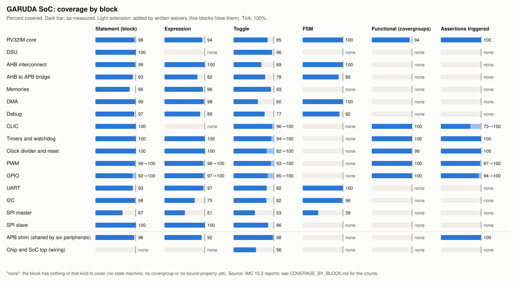

# GARUDA SoC: coverage by block

Written by `tools/gen/cov_chart.py` on 2026-10-14 from IMC 15.2 reports, tree `afbd3e1` plus uncommitted changes. No figure here is typed by hand: each is a covered/total pair IMC printed, added over the modules of the block. To make it again: `make cov_chart`.

## How to read it

- **Two sources.** The five blocks that have a UVM environment (CLIC, timers, clock and reset, PWM, GPIO) are measured on that environment's own runs and shown twice: as measured, and after the written waivers. The other eleven are measured on the 121 directed runs of `flow/regress/garuda.vsif` merged together, counted per module, with no waiver: none has been written for them yet. A hole in those rows is a hole, not a waived item.
- **Statement, expression, toggle, FSM** are IMC's block, expression, toggle and FSM (states, transitions, arcs) metrics. **Functional** is covergroup bins. **Assertions triggered** counts bound properties and cover properties that finished at least once: a property that never triggered has checked nothing, however many tests passed.
- The sign-off bar (`flow/0_signoff_criteria.md`) is 100% functional and at least 95% code coverage with every hole waived in writing. A block is closed only when it meets it.

## Summary

| Block | Track | Measured on | Statement | Expression | Toggle | FSM | Functional | Assertions triggered | Waivers |
|---|---|---|---|---|---|---|---|---|---|
| RV32IM core | A | all directed tests, merged | 97.6% (285/292) | 94.3% (66/70) | 84.6% (7873/9310) | 100.0% (4/4) | 94.2% (1037/1101) | 100.0% (140/140) | none written |
| DSU | A | all directed tests, merged | 100.0% (63/63) | none | 95.6% (3601/3765) | none | none | none | none written |
| AHB interconnect | A | all directed tests, merged | 98.6% (72/73) | 100.0% (9/9) | 69.0% (1084/1572) | 100.0% (7/7) | none | none | none written |
| AHB to APB bridge | A | all directed tests, merged | 93.0% (40/43) | 81.8% (9/11) | 78.3% (1100/1404) | 89.3% (25/28) | none | none | none written |
| Memories | A | all directed tests, merged | 85.1% (57/67) | 95.7% (22/23) | 92.8% (914/985) | none | none | none | none written |
| DMA | A | all directed tests, merged | 99.1% (106/107) | 97.8% (45/46) | 60.3% (2151/3566) | 100.0% (13/13) | none | none | none written |
| Debug | A | all directed tests, merged | 96.5% (166/172) | 88.6% (31/35) | 77.1% (1224/1587) | 91.7% (44/48) | none | none | none written |
| CLIC | B | the block's UVM environment | 100.0% (20/20) | none | 96.1% (1119/1165), after waivers 100.0% (1119/1119) | none | 100.0% (417/417) | 73.2% (60/82), after waivers 100.0% (60/60) | 68, in `flow/cov/clic_exclusions.tcl` |
| Timers and watchdog | B | the block's UVM environment | 100.0% (68/68) | 100.0% (3/3) | 93.8% (1383/1475), after waivers 100.0% (1383/1383) | none | 100.0% (145/145) | 100.0% (36/36) | 93, in `flow/cov/timers_exclusions.tcl` |
| Clock divider and reset | B | the block's UVM environment | 100.0% (84/84) | 100.0% (13/13) | 82.2% (240/292), after waivers 100.0% (240/240) | none | 100.0% (106/106) | 100.0% (42/42) | 55, in `flow/cov/crg_exclusions.tcl` |
| PWM | B | the block's UVM environment | 98.0% (98/100), after waivers 100.0% (98/98) | 96.0% (24/25), after waivers 100.0% (21/21) | 92.9% (624/672), after waivers 100.0% (624/624) | none | 100.0% (275/275) | 96.2% (76/79), after waivers 100.0% (76/76) | 60, in `flow/cov/pwm_exclusions.tcl` |
| GPIO | B | the block's UVM environment | 58.4% (156/267), after waivers 100.0% (156/156) | 93.5% (29/31), after waivers 100.0% (22/22) | 55.5% (680/1225), after waivers 100.0% (296/296) | none | 100.0% (214/214) | 94.7% (36/38), after waivers 100.0% (36/36) | 666, in `flow/cov/gpio_exclusions.tcl` |
| UART | B | all directed tests, merged | 92.9% (210/226) | 97.0% (32/33) | 82.5% (513/622) | 100.0% (28/28) | none | none | none written |
| I2C | B | all directed tests, merged | 98.4% (184/187) | 75.0% (3/4) | 81.6% (391/479) | 98.2% (55/56) | none | none | none written |
| SPI master | B | all directed tests, merged | 67.3% (165/245) | 50.7% (35/69) | 53.0% (1013/1910) | 38.9% (21/54) | none | none | none written |
| SPI slave | B | all directed tests, merged | 100.0% (62/62) | 100.0% (6/6) | 86.0% (245/285) | none | none | none | none written |
| APB shim (shared by six peripherals) | B | all directed tests, merged | 96.4% (27/28) | 92.3% (12/13) | 98.1% (202/206) | none | none | 100.0% (17/17) | none written |
| Chip and SoC top (wiring) | B | all directed tests, merged | none | none | 55.7% (1513/2715) | none | none | none | none written |

Over the sixteen blocks, counting items (waived items removed for the five blocks that have waivers): statement 93.5% (1836/1963), expression 86.8% (317/365), toggle 81.6% (23771/29147), FSM 82.8% (197/238); all four together 82.4% (26121/31713).

## Block by block

### RV32IM core

Plan: `tb/core/GARUDA_CORE_vplan.csv` (41 features, 69 checks and coverage items). Track A.

Measured on all directed tests merged, per module. No waiver applied.

| Module | Statement | Expression | Toggle | FSM |
|---|---|---|---|---|
| `garuda_core_top` | 100.0% (9/9) | none | 77.5% (1428/1842) | none |
| `core_clk_gate` | 100.0% (3/3) | none | 80.0% (4/5) | none |
| `garuda_if_stage_top` | none | none | 84.2% (267/317) | none |
| `garuda_pc_gen` | 100.0% (10/10) | none | 97.0% (129/133) | none |
| `garuda_iport_ahb_master` | 100.0% (19/19) | 100.0% (9/9) | 82.1% (253/308) | none |
| `garuda_prefetch_buffer` | 100.0% (15/15) | none | 97.3% (144/148) | none |
| `if_id` | 100.0% (7/7) | none | 69.1% (94/136) | none |
| `id_stage` | none | none | 98.8% (555/562) | none |
| `decode_control` | 96.9% (63/65) | 100.0% (20/20) | 100.0% (117/117) | none |
| `imm_gen` | 100.0% (8/8) | none | 86.7% (280/323) | none |
| `regfile` | 100.0% (3/3) | 100.0% (11/11) | 100.0% (178/178) | none |
| `branch_predict` | none | none | 96.1% (220/229) | none |
| `hazard_forward_unit` | none | none | 100.0% (17/17) | none |
| `id_ex` | 100.0% (8/8) | none | 91.1% (430/472) | none |
| `forward_unit` | none | 100.0% (12/12) | 100.0% (28/28) | none |
| `ex_stage` | 100.0% (8/8) | none | 87.5% (836/955) | none |
| `alu` | 100.0% (13/13) | none | 100.0% (105/105) | none |
| `mul32` | none | none | 100.0% (233/233) | none |
| `branch_unit` | 100.0% (8/8) | none | 98.2% (266/271) | none |
| `csr_rw` | none | none | 100.0% (115/115) | none |
| `ex_mem` | 100.0% (7/7) | none | 82.0% (182/222) | none |
| `mem_stage` | none | none | 96.3% (392/407) | none |
| `load_store_unit` | 100.0% (4/4) | none | 99.1% (106/107) | none |
| `d_port_ahb_master` | 92.3% (12/13) | 100.0% (6/6) | 97.3% (144/148) | 100.0% (4/4) |
| `load_formatter` | 100.0% (14/14) | none | 100.0% (96/96) | none |
| `mem_wb_reg` | 100.0% (5/5) | none | 100.0% (81/81) | none |
| `wb_stage` | none | none | 100.0% (76/76) | none |
| `csr_file` | 93.9% (62/66) | 66.7% (8/12) | 57.7% (491/851) | none |
| `clic_ctrl` | none | none | 96.4% (108/112) | none |
| `trap_ctrl` | 100.0% (7/7) | none | 64.9% (362/558) | none |
| `pipe_ctrl` | none | none | 86.1% (136/158) | none |
| **whole block** | 97.6% (285/292) | 94.3% (66/70) | 84.6% (7873/9310) | 100.0% (4/4) |

Functional coverage: 94.2% (1037/1101).

| Covergroups of | Bins covered |
|---|---|
| garuda_cov (tb_boot: ISA and sanity programs) | 78.2% (197/252) |
| unit_alu | 100.0% (26/26) |
| unit_branch_predict | 100.0% (14/14) |
| unit_branch_unit | 100.0% (29/29) |
| unit_csr_rw | 84.8% (28/33) |
| unit_d_port_ahb_master | 100.0% (28/28) |
| unit_decode_control | 100.0% (59/59) |
| unit_garuda_if_stage_top | 100.0% (22/22) |
| unit_garuda_iport_ahb_master | 100.0% (31/31) |
| unit_garuda_pc_gen | 100.0% (13/13) |
| unit_garuda_prefetch_buffer | 88.2% (30/34) |
| unit_hazard_forward_unit | 100.0% (105/105) |
| unit_id_stage | 100.0% (154/154) |
| unit_imm_gen | 100.0% (22/22) |
| unit_load_formatter | 100.0% (39/39) |
| unit_load_store_unit | 100.0% (32/32) |
| unit_mem_stage | 100.0% (60/60) |
| unit_mem_wb_reg | 100.0% (17/17) |
| unit_mul32 | 100.0% (29/29) |
| unit_reg_file | 100.0% (102/102) |

Assertions: 100.0% (140/140) triggered.

**Exclusions:** none written. They are written when the block is closed (step R8 of the block recipe), each with its reason and, where the reason is "unreachable", a JasperGold run that confirms it.

### DSU

Plan: `tb/dsu/GARUDA_DSU_vplan.csv` (28 features, 44 checks and coverage items). Track A.

Measured on all directed tests merged, per module. No waiver applied.

| Module | Statement | Expression | Toggle | FSM |
|---|---|---|---|---|
| `dsu_top` | 100.0% (5/5) | none | 99.5% (568/571) | none |
| `dsu_decoder` | none | none | 100.0% (142/142) | none |
| `saturation_unit` | 100.0% (5/5) | none | 63.4% (166/262) | none |
| `mac_cluster` | 100.0% (5/5) | none | 99.4% (521/524) | none |
| `mac_unit` | 100.0% (24/24) | none | 95.1% (1036/1089) | none |
| `operand_router` | 100.0% (5/5) | none | 98.8% (161/163) | none |
| `mult_16x16` | none | none | 100.0% (64/64) | none |
| `csa_3to2` | none | none | 99.2% (243/245) | none |
| `kogge_stone_49` | none | none | 98.6% (146/148) | none |
| `barrel_shifter` | none | none | 100.0% (279/279) | none |
| `readback_mux` | none | none | 100.0% (114/114) | none |
| `result_selector` | 100.0% (5/5) | none | 100.0% (130/130) | none |
| `overflow_flag` | 100.0% (7/7) | none | 66.7% (6/9) | none |
| `dsu_stall` | 100.0% (7/7) | none | 100.0% (25/25) | none |
| **whole block** | 100.0% (63/63) | none | 95.6% (3601/3765) | none |

Functional coverage: no covergroup is defined for this block yet (it has directed benches only).

Assertions: no property is bound to this block yet.

**Exclusions:** none written. They are written when the block is closed (step R8 of the block recipe), each with its reason and, where the reason is "unreachable", a JasperGold run that confirms it.

### AHB interconnect

Plan: `tb/ahb/GARUDA_AHB_vplan.csv` (24 features, 36 checks and coverage items). Track A.

Measured on all directed tests merged, per module. No waiver applied.

| Module | Statement | Expression | Toggle | FSM |
|---|---|---|---|---|
| `ahb_interconnect` | none | none | 68.4% (511/747) | none |
| `ahb_arbiter` | 100.0% (13/13) | 100.0% (3/3) | 90.3% (28/31) | none |
| `ahb_master_mux` | 100.0% (13/13) | 100.0% (3/3) | 55.7% (214/384) | none |
| `ahb_decoder` | 100.0% (6/6) | none | 67.6% (25/37) | none |
| `ahb_default_slave` | 92.3% (12/13) | none | 25.6% (11/43) | 100.0% (7/7) |
| `ahb_slave_mux` | 100.0% (21/21) | none | 84.4% (184/218) | none |
| `ahb_master_port` | 100.0% (7/7) | 100.0% (3/3) | 99.1% (111/112) | none |
| **whole block** | 98.6% (72/73) | 100.0% (9/9) | 69.0% (1084/1572) | 100.0% (7/7) |

Functional coverage: no covergroup is defined for this block yet (it has directed benches only).

Assertions: no property is bound to this block yet.

**Exclusions:** none written. They are written when the block is closed (step R8 of the block recipe), each with its reason and, where the reason is "unreachable", a JasperGold run that confirms it.

### AHB to APB bridge

Plan: `tb/ahb2apb/GARUDA_AHB2APB_vplan.csv` (30 features, 50 checks and coverage items). Track A.

Measured on all directed tests merged, per module. No waiver applied.

| Module | Statement | Expression | Toggle | FSM |
|---|---|---|---|---|
| `ahb2apb_bridge` | 88.5% (23/26) | 81.8% (9/11) | 79.1% (598/756) | 85.0% (17/20) |
| `ahb2apb_apb_fsm` | 100.0% (15/15) | none | 94.8% (184/194) | 100.0% (8/8) |
| `ahb2apb_fabric` | 100.0% (2/2) | none | 70.0% (318/454) | none |
| **whole block** | 93.0% (40/43) | 81.8% (9/11) | 78.3% (1100/1404) | 89.3% (25/28) |

Functional coverage: no covergroup is defined for this block yet (it has directed benches only).

Assertions: no property is bound to this block yet.

**Exclusions:** none written. They are written when the block is closed (step R8 of the block recipe), each with its reason and, where the reason is "unreachable", a JasperGold run that confirms it.

### Memories

Plan: `tb/mem/GARUDA_MEM_vplan.csv` (28 features, 40 checks and coverage items). Track A.

Measured on all directed tests merged, per module. No waiver applied.

| Module | Statement | Expression | Toggle | FSM |
|---|---|---|---|---|
| `isram_top` | 66.7% (2/3) | none | 90.6% (183/202) | none |
| `ahb_mem_slave_if` | 95.8% (23/24) | 94.1% (16/17) | 96.1% (317/330) | none |
| `sram_wrapper` | 90.5% (19/21) | 100.0% (3/3) | 100.0% (85/85) | none |
| `bootrom_top` | 66.7% (2/3) | none | 89.8% (176/196) | none |
| `sram_wrapper, generate init_T` | 100.0% (1/1) | none | none | none |
| `dsram_top` | 66.7% (10/15) | 100.0% (3/3) | 89.0% (153/172) | none |
| **whole block** | 85.1% (57/67) | 95.7% (22/23) | 92.8% (914/985) | none |

Functional coverage: no covergroup is defined for this block yet (it has directed benches only).

Assertions: no property is bound to this block yet.

**Exclusions:** none written. They are written when the block is closed (step R8 of the block recipe), each with its reason and, where the reason is "unreachable", a JasperGold run that confirms it.

### DMA

Plan: `tb/dma/GARUDA_DMA_vplan.csv` (41 features, 64 checks and coverage items). Track A.

Measured on all directed tests merged, per module. No waiver applied.

| Module | Statement | Expression | Toggle | FSM |
|---|---|---|---|---|
| `dma_top` | none | none | 55.5% (707/1275) | none |
| `dma_apb_slave` | 100.0% (21/21) | none | 54.1% (660/1221) | none |
| `dma_chan` | 100.0% (51/51) | 100.0% (26/26) | 68.8% (245/356) | none |
| `dma_arbiter` | 100.0% (4/4) | 100.0% (4/4) | 100.0% (13/13) | none |
| `dma_engine` | 96.8% (30/31) | 93.8% (15/16) | 75.0% (526/701) | 100.0% (13/13) |
| **whole block** | 99.1% (106/107) | 97.8% (45/46) | 60.3% (2151/3566) | 100.0% (13/13) |

Functional coverage: no covergroup is defined for this block yet (it has directed benches only).

Assertions: no property is bound to this block yet.

**Exclusions:** none written. They are written when the block is closed (step R8 of the block recipe), each with its reason and, where the reason is "unreachable", a JasperGold run that confirms it.

### Debug

Plan: `tb/debug/GARUDA_DEBUG_vplan.csv` (36 features, 52 checks and coverage items). Track A.

Measured on all directed tests merged, per module. No waiver applied.

| Module | Statement | Expression | Toggle | FSM |
|---|---|---|---|---|
| `debug_top` | none | none | 86.0% (388/451) | none |
| `jtag_tap` | 100.0% (36/36) | none | 100.0% (30/30) | 90.5% (38/42) |
| `dtm` | 94.3% (33/35) | 94.1% (16/17) | 83.9% (167/199) | none |
| `dmi_cdc` | 100.0% (15/15) | none | 100.0% (17/17) | none |
| `debug_module` | 95.8% (68/71) | 83.3% (15/18) | 65.0% (420/646) | none |
| `sba_master` | 93.3% (14/15) | none | 82.8% (202/244) | 100.0% (6/6) |
| **whole block** | 96.5% (166/172) | 88.6% (31/35) | 77.1% (1224/1587) | 91.7% (44/48) |

Functional coverage: no covergroup is defined for this block yet (it has directed benches only).

Assertions: no property is bound to this block yet.

**Exclusions:** none written. They are written when the block is closed (step R8 of the block recipe), each with its reason and, where the reason is "unreachable", a JasperGold run that confirms it.

### CLIC

Plan: `tb/clic/GARUDA_CLIC_vplan.csv` (35 features, 67 checks and coverage items). Track B.

Measured on the UVM environment (22 runs: register test, directed test, random seeds), DUT instance only.

| Metric | As measured | After waivers | Items waived |
|---|---|---|---|
| Block | 100.0% (20/20) | 100.0% (20/20) | 0 |
| Toggle | 96.1% (1119/1165) | 100.0% (1119/1119) | 46 |
| Assertion | 73.2% (60/82) | 100.0% (60/60) | 22 |
| Functional (covergroup bins) | 100.0% (417/417) | 100.0% (417/417) | 0 |

**Exclusions and their justifications** (`flow/cov/clic_exclusions.tcl`, 68 lines):

| Metric | Where | Items | Justification |
|---|---|---|---|
| toggle | `clic_top` | 11: `ie` | enable bit of an ID with no source: hardwired 0 by GARUDA_CLIC_ID_MASK, checked by a_reserved_ids |
| toggle | `clic_top.u_apb` | 22: `ie_o`, `ie_q` | enable bit of an ID with no source: hardwired 0 by GARUDA_CLIC_ID_MASK, checked by a_reserved_ids |
| toggle | `clic_top.u_sel` | 11: `cand_i` | candidate bit of an ID with no source: its enable is hardwired 0, so enable AND pending is always 0 |
| toggle | `clic_top` | 1: `pready_o` | constant 1: the block is zero-wait by specification (CLIC section 5), checked by a_pready |
| toggle | `clic_top.u_apb` | 1: `pready_o` | constant 1: the block is zero-wait by specification (CLIC section 5), checked by a_pready |
| assertion | `clic_top.u_clic_sva.g_n\[0\]` | 2: `a_tiebreak_lowest_id`, `a_winner_max_level` | ID 0 has no source and can never be a candidate, so this property cannot trigger; the 21 instances for assigned IDs all trigger |
| assertion | `clic_top.u_clic_sva.g_n\[7\]` | 2: `a_tiebreak_lowest_id`, `a_winner_max_level` | ID 7 has no source and can never be a candidate, so this property cannot trigger; the 21 instances for assigned IDs all trigger |
| assertion | `clic_top.u_clic_sva.g_n\[23\]` | 2: `a_tiebreak_lowest_id`, `a_winner_max_level` | ID 23 has no source and can never be a candidate, so this property cannot trigger; the 21 instances for assigned IDs all trigger |
| assertion | `clic_top.u_clic_sva.g_n\[24\]` | 2: `a_tiebreak_lowest_id`, `a_winner_max_level` | ID 24 has no source and can never be a candidate, so this property cannot trigger; the 21 instances for assigned IDs all trigger |
| assertion | `clic_top.u_clic_sva.g_n\[25\]` | 2: `a_tiebreak_lowest_id`, `a_winner_max_level` | ID 25 has no source and can never be a candidate, so this property cannot trigger; the 21 instances for assigned IDs all trigger |
| assertion | `clic_top.u_clic_sva.g_n\[26\]` | 2: `a_tiebreak_lowest_id`, `a_winner_max_level` | ID 26 has no source and can never be a candidate, so this property cannot trigger; the 21 instances for assigned IDs all trigger |
| assertion | `clic_top.u_clic_sva.g_n\[27\]` | 2: `a_tiebreak_lowest_id`, `a_winner_max_level` | ID 27 has no source and can never be a candidate, so this property cannot trigger; the 21 instances for assigned IDs all trigger |
| assertion | `clic_top.u_clic_sva.g_n\[28\]` | 2: `a_tiebreak_lowest_id`, `a_winner_max_level` | ID 28 has no source and can never be a candidate, so this property cannot trigger; the 21 instances for assigned IDs all trigger |
| assertion | `clic_top.u_clic_sva.g_n\[29\]` | 2: `a_tiebreak_lowest_id`, `a_winner_max_level` | ID 29 has no source and can never be a candidate, so this property cannot trigger; the 21 instances for assigned IDs all trigger |
| assertion | `clic_top.u_clic_sva.g_n\[30\]` | 2: `a_tiebreak_lowest_id`, `a_winner_max_level` | ID 30 has no source and can never be a candidate, so this property cannot trigger; the 21 instances for assigned IDs all trigger |
| assertion | `clic_top.u_clic_sva.g_n\[31\]` | 2: `a_tiebreak_lowest_id`, `a_winner_max_level` | ID 31 has no source and can never be a candidate, so this property cannot trigger; the 21 instances for assigned IDs all trigger |

### Timers and watchdog

Plan: `tb/timers/GARUDA_TIMERS_vplan.csv` (43 features, 75 checks and coverage items). Track B.

Measured on the UVM environment (22 runs: register test, directed test, random seeds), DUT instance only.

| Metric | As measured | After waivers | Items waived |
|---|---|---|---|
| Block | 100.0% (68/68) | 100.0% (68/68) | 0 |
| Expression | 100.0% (3/3) | 100.0% (3/3) | 0 |
| Toggle | 93.8% (1383/1475) | 100.0% (1383/1383) | 92 |
| Assertion | 100.0% (36/36) | 100.0% (36/36) | 0 |
| Functional (covergroup bins) | 100.0% (145/145) | 100.0% (145/145) | 0 |

**Exclusions and their justifications** (`flow/cov/timers_exclusions.tcl`, 93 lines):

| Metric | Where | Items | Justification |
|---|---|---|---|
| toggle | `timers_top` | 30: `ctl` | reserved bit of WDTCTL, reads 0: constant by specification, checked by the scoreboard on every WDTCTL read |
| toggle | `timers_top.u_apb` | 30: `wdtctl_i` | reserved bit of WDTCTL, reads 0: constant by specification, checked by the scoreboard on every WDTCTL read |
| toggle | `timers_top.u_wdt` | 30: `ctl_o` | reserved bit of WDTCTL, reads 0: constant by specification, checked by the scoreboard on every WDTCTL read |
| toggle | `timers_top` | 1: `pready_o` | PREADY is tied high, no wait states: checked by a_pready and sb_pready |
| toggle | `timers_top.u_apb` | 1: `pready_o` | PREADY is tied high, no wait states: checked by a_pready and sb_pready |
| toggle | `timers_top.u_timers_sva` | 1: `pready_o` | PREADY is tied high, no wait states: checked by a_pready and sb_pready |

### Clock divider and reset

Plan: `tb/clk_div/GARUDA_CLKRST_vplan.csv` (34 features, 47 checks and coverage items). Track B.

Measured on the UVM environment (22 runs: register test, directed test, random seeds), DUT instance only.

| Metric | As measured | After waivers | Items waived |
|---|---|---|---|
| Block | 100.0% (84/84) | 100.0% (84/84) | 0 |
| Expression | 100.0% (13/13) | 100.0% (13/13) | 0 |
| Toggle | 82.2% (240/292) | 100.0% (240/240) | 52 |
| Assertion | 100.0% (42/42) | 100.0% (42/42) | 0 |
| Functional (covergroup bins) | 100.0% (106/106) | 100.0% (106/106) | 0 |

**Exclusions and their justifications** (`flow/cov/crg_exclusions.tcl`, 55 lines):

| Metric | Where | Items | Justification |
|---|---|---|---|
| toggle | `reset_ctrl` | 25: `prdata_o` | read-data bit that is 0 in every register of this window: constant by specification, checked by the scoreboard on every read |
| toggle | `reset_ctrl.u_apb` | 25: `prdata_o` | read-data bit that is 0 in every register of this window: constant by specification, checked by the scoreboard on every read |
| toggle | `reset_ctrl` | 1: `pready_o` | PREADY is tied high, no wait states: checked by a_pready and sb_pready |
| toggle | `reset_ctrl.u_apb` | 1: `pready_o` | PREADY is tied high, no wait states: checked by a_pready and sb_pready |
| toggle | `reset_ctrl.u_reset_ctrl_sva` | 1: `pready_o` | PREADY is tied high, no wait states: checked by a_pready and sb_pready |
| expression | `clk_div.u_clk_div_sva` | 1: `1.1` | a guard in the checker, not design logic: the reference period is measured before hclk first moves, so the case reference-period-unknown with an hclk edge already seen does not occur |
| expression | `clk_div.u_clk_div_sva` | 1: `4.1` | the same guard for pclk in the checker, not design logic |

### PWM

Plan: `tb/pwm/GARUDA_PWM_vplan.csv` (27 features, 45 checks and coverage items). Track B.

Measured on the UVM environment (22 runs: register test, directed test, random seeds), DUT instance only.

| Metric | As measured | After waivers | Items waived |
|---|---|---|---|
| Block | 98.0% (98/100) | 100.0% (98/98) | 2 |
| Expression | 96.0% (24/25) | 100.0% (21/21) | 4 |
| Toggle | 92.9% (624/672) | 100.0% (624/624) | 48 |
| Assertion | 96.2% (76/79) | 100.0% (76/76) | 3 |
| Functional (covergroup bins) | 100.0% (275/275) | 100.0% (275/275) | 0 |

**Exclusions and their justifications** (`flow/cov/pwm_exclusions.tcl`, 60 lines):

| Metric | Where | Items | Justification |
|---|---|---|---|
| toggle | `garuda_pwm_top` | 18: `prdata_o`, `reg_rdata` | read-data bit that is 0 in every register of this block: constant by specification, checked by the scoreboard on every read |
| toggle | `garuda_pwm_top.u_shim` | 18: `ip_prdata_i`, `prdata_o` | read-data bit that is 0 in every register of this block: constant by specification, checked by the scoreboard on every read |
| toggle | `garuda_pwm_top` | 1: `pready_o` | PREADY is tied high, no wait states: checked by a_shim_pready and sb_pready |
| toggle | `garuda_pwm_top.u_shim` | 1: `pready_o` | PREADY is tied high, no wait states: checked by a_shim_pready and sb_pready |
| toggle | `garuda_pwm_top.u_shim.u_shim_sva` | 1: `pready_o` | PREADY is tied high, no wait states: checked by a_shim_pready and sb_pready |
| toggle | `garuda_pwm_top.u_shim` | 1: `ip_pready_i` | tied high in garuda_pwm_top: the registers answer in the same cycle |
| toggle | `garuda_pwm_top.u_shim` | 9: `dma_ack_i`, `dma_req_o`, `holdoff_q`, `pad_async_i`, `pad_sync_o`, `rx_avail_i` and 3 more | tied off in garuda_pwm_top: the PWM has no DMA channel and no pad input; covered in the blocks that use the shim's DMA and synchroniser |
| toggle | `garuda_pwm_top.u_shim.u_shim_sva` | 4: `dma_ack_i`, `dma_req_o`, `rx_avail_i`, `tx_space_i` | tied off in garuda_pwm_top: the PWM has no DMA channel and no pad input; covered in the blocks that use the shim's DMA and synchroniser |
| toggle | `garuda_pwm_top.u_pwm_sva` | 1: `dma_req` | tied off in garuda_pwm_top: the PWM has no DMA channel and no pad input; covered in the blocks that use the shim's DMA and synchroniser |
| assertion | `garuda_pwm_top.u_shim.u_shim_sva` | 2: `a_shim_dma_gate`, `a_shim_dma_holdoff` | tied off in garuda_pwm_top: the PWM has no DMA channel and no pad input; covered in the blocks that use the shim's DMA and synchroniser |
| block | `garuda_pwm_top.u_shim` | 1: `30` | the shim's report that an IP held PREADY low: the PWM registers answer in the same cycle (ip_pready_i tied high), so the report can never print here |
| expression | `garuda_pwm_top.u_shim` | 1: `4.1` | condition of the same report: ip_pready_i is tied high in garuda_pwm_top |
| assertion | `garuda_pwm_top.u_shim.u_shim_sva` | 1: `c_shim_hole` | the register map of the PWM has no hole below its limit (all eight words 0x00 to 0x1C are registers), so this cover cannot happen here; it is seen in the GPIO, the I2C and the SPI master |
| block | `garuda_pwm_top.u_shim` | 1: `27` | the shim stops the simulation if its parameter IP_LIMIT is above 0x100, which the 64-bit register map cannot describe; the parameter is a constant below that here, so the branch is never taken |

### GPIO

Plan: `tb/gpio/GARUDA_GPIO_vplan.csv` (27 features, 41 checks and coverage items). Track B.

Measured on the UVM environment (22 runs: register test, directed test, random seeds), DUT instance only.

| Metric | As measured | After waivers | Items waived |
|---|---|---|---|
| Block | 58.4% (156/267) | 100.0% (156/156) | 111 |
| Expression | 93.5% (29/31) | 100.0% (22/22) | 9 |
| Toggle | 55.5% (680/1225) | 100.0% (296/296) | 81 |
| Assertion | 94.7% (36/38) | 100.0% (36/36) | 2 |
| Functional (covergroup bins) | 100.0% (214/214) | 100.0% (214/214) | 0 |

**Exclusions and their justifications** (`flow/cov/gpio_exclusions.tcl`, 666 lines):

| Metric | Where | Items | Justification |
|---|---|---|---|
| toggle | `garuda_gpio_top` | 36: `ip_prdata`, `prdata_o` | read-data bit that is 0 in every register of this block: constant by specification, checked by the scoreboard on every read |
| toggle | `garuda_gpio_top.u_shim` | 36: `ip_prdata_i`, `prdata_o` | read-data bit that is 0 in every register of this block: constant by specification, checked by the scoreboard on every read |
| toggle | `garuda_gpio_top.u_gpio` | 24: `PRDATA` | read-data bit that is 0 in every register of this block: constant by specification, checked by the scoreboard on every read |
| toggle | `garuda_gpio_top` | 2: `ip_pready`, `pready_o` | PREADY is tied high, no wait states: checked by a_shim_pready and sb_pready |
| toggle | `garuda_gpio_top.u_shim` | 2: `ip_pready_i`, `pready_o` | PREADY is tied high, no wait states: checked by a_shim_pready and sb_pready |
| toggle | `garuda_gpio_top.u_shim.u_shim_sva` | 1: `pready_o` | PREADY is tied high, no wait states: checked by a_shim_pready and sb_pready |
| toggle | `garuda_gpio_top.u_gpio` | 1: `PREADY` | PREADY is tied high, no wait states: checked by a_shim_pready and sb_pready |
| toggle | `garuda_gpio_top.u_gpio` | 1: `PSLVERR` | tied low in the vendored block and left unconnected: the shim makes PSLVERR |
| toggle | `garuda_gpio_top.u_shim` | 5: `dma_ack_i`, `dma_req_o`, `holdoff_q`, `rx_avail_i`, `tx_space_i` | tied off in garuda_gpio_top: the GPIO has no DMA channel; covered in the blocks that use the shim's DMA logic |
| toggle | `garuda_gpio_top.u_shim.u_shim_sva` | 4: `dma_ack_i`, `dma_req_o`, `rx_avail_i`, `tx_space_i` | tied off in garuda_gpio_top: the GPIO has no DMA channel; covered in the blocks that use the shim's DMA logic |
| toggle | `garuda_gpio_top.u_gpio_sva` | 1: `dma_req` | tied off in garuda_gpio_top: the GPIO has no DMA channel; covered in the blocks that use the shim's DMA logic |
| assertion | `garuda_gpio_top.u_shim.u_shim_sva` | 2: `a_shim_dma_gate`, `a_shim_dma_holdoff` | tied off in garuda_gpio_top: the GPIO has no DMA channel; covered in the blocks that use the shim's DMA logic |
| toggle | `garuda_gpio_top.u_gpio` | 77: `s_cg_en`, `s_clk_en` | logic of a pin that does not exist: the vendored block is written for 64 pins and built with PAD_NUM = 2 |
| block | `garuda_gpio_top.u_gpio` | 19: `123`, `133`, `143`, `153`, `163`, `168` and 13 more | logic of a pin that does not exist: the vendored block is written for 64 pins and built with PAD_NUM = 2 |
| toggle | `garuda_gpio_top.u_gpio` | 1: `dft_cg_enable_i` | tied low until scan insertion: GPIO spec N-9.3, open item OPEN-G1 |
| block | `garuda_gpio_top.u_shim` | 1: `30` | the shim's report that an IP held PREADY low: the vendored GPIO ties PREADY high, so the report can never print here |
| expression | `garuda_gpio_top.u_shim` | 1: `4.1` | condition of the same report: ip_pready_i is tied high by the vendored GPIO |
| block | `garuda_gpio_top.u_shim` | 1: `27` | the shim stops the simulation if its parameter IP_LIMIT is above 0x100, which the 64-bit register map cannot describe; the parameter is a constant below that here, so the branch is never taken |
| block | `garuda_gpio_top.u_gpio` | 90: `100`, `102`, `104`, `105`, `106`, `107` and 84 more | reached only through an offset that is not a GARUDA register (0x20, 0x2C to 0x7C: the vendored file's bank for pads 32 to 63 and PADCFG1 to 7; GARUDA has two pads). Since the shim's register map of 2026-10-13 the IP is not selected there (GPIO-2 item 3, AUD-13), so the bus cannot reach it; until then it was covered only by writes to those non-registers. Unreachability to be confirmed in JasperGold (plan task 4.4) |
| expression | `garuda_gpio_top.u_gpio` | 1: `2.1` | reached only through an offset that is not a GARUDA register (0x20, 0x2C to 0x7C: the vendored file's bank for pads 32 to 63 and PADCFG1 to 7; GARUDA has two pads). Since the shim's register map of 2026-10-13 the IP is not selected there (GPIO-2 item 3, AUD-13), so the bus cannot reach it; until then it was covered only by writes to those non-registers. Unreachability to be confirmed in JasperGold (plan task 4.4) |
| toggle | `garuda_gpio_top.u_gpio` | 360: `s_gpio_dir`, `s_gpio_en`, `s_gpio_inten`, `s_gpio_out`, `s_write_cfg`, `s_write_dir` and 4 more | reached only through an offset that is not a GARUDA register (0x20, 0x2C to 0x7C: the vendored file's bank for pads 32 to 63 and PADCFG1 to 7; GARUDA has two pads). Since the shim's register map of 2026-10-13 the IP is not selected there (GPIO-2 item 3, AUD-13), so the bus cannot reach it; until then it was covered only by writes to those non-registers. Unreachability to be confirmed in JasperGold (plan task 4.4) |

### UART

Plan: `tb/uart/GARUDA_UART_vplan.csv` (33 features, 53 checks and coverage items). Track B.

Measured on all directed tests merged, per module. No waiver applied.

| Module | Statement | Expression | Toggle | FSM |
|---|---|---|---|---|
| `garuda_uart_top` | 100.0% (10/10) | none | 77.2% (159/206) | none |
| `apb_uart_sv` | 100.0% (28/28) | 100.0% (8/8) | 78.0% (124/159) | none |
| `uart_rx` | 94.8% (73/77) | 100.0% (6/6) | 91.3% (84/92) | 100.0% (14/14) |
| `uart_tx` | 96.2% (51/53) | none | 91.4% (74/81) | 100.0% (14/14) |
| `io_generic_fifo` | 100.0% (29/29) | 94.7% (18/19) | 100.0% (46/46) | none |
| `uart_interrupt` | 65.5% (19/29) | none | 68.4% (26/38) | none |
| **whole block** | 92.9% (210/226) | 97.0% (32/33) | 82.5% (513/622) | 100.0% (28/28) |

Functional coverage: no covergroup is defined for this block yet (it has directed benches only).

Assertions: no property is bound to this block yet.

**Exclusions:** none written. They are written when the block is closed (step R8 of the block recipe), each with its reason and, where the reason is "unreachable", a JasperGold run that confirms it.

### I2C

Plan: `tb/i2c/GARUDA_I2C_vplan.csv` (32 features, 49 checks and coverage items). Track B.

Measured on all directed tests merged, per module. No waiver applied.

| Module | Statement | Expression | Toggle | FSM |
|---|---|---|---|---|
| `garuda_i2c_top` | 100.0% (53/53) | none | 84.9% (253/298) | none |
| `i2c_master_byte_ctrl` | 98.2% (55/56) | none | 83.1% (64/77) | 94.1% (16/17) |
| `i2c_master_bit_ctrl` | 97.4% (76/78) | 75.0% (3/4) | 71.2% (74/104) | 100.0% (39/39) |
| **whole block** | 98.4% (184/187) | 75.0% (3/4) | 81.6% (391/479) | 98.2% (55/56) |

Functional coverage: no covergroup is defined for this block yet (it has directed benches only).

Assertions: no property is bound to this block yet.

**Exclusions:** none written. They are written when the block is closed (step R8 of the block recipe), each with its reason and, where the reason is "unreachable", a JasperGold run that confirms it.

### SPI master

Plan: `tb/spi_master/GARUDA_SPIM_vplan.csv` (27 features, 42 checks and coverage items). Track B.

Measured on all directed tests merged, per module. No waiver applied.

| Module | Statement | Expression | Toggle | FSM |
|---|---|---|---|---|
| `garuda_spim_top` | 100.0% (5/5) | none | 79.7% (196/246) | none |
| `apb_spi_master` | 34.9% (15/43) | 10.0% (2/20) | 47.5% (221/465) | 16.7% (2/12) |
| `spi_master_apb_if` | 91.3% (21/23) | 100.0% (4/4) | 50.6% (180/356) | none |
| `spi_master_fifo` | 93.1% (27/29) | 73.7% (14/19) | 87.8% (79/90) | none |
| `spi_master_controller` | 54.4% (43/79) | 35.3% (6/17) | 33.4% (107/320) | 39.3% (11/28) |
| `spi_master_clkgen` | 100.0% (13/13) | 100.0% (3/3) | 26.5% (13/49) | none |
| `spi_master_tx` | 86.4% (19/22) | 100.0% (6/6) | 44.8% (86/192) | 100.0% (4/4) |
| `spi_master_rx` | 71.0% (22/31) | none | 68.2% (131/192) | 40.0% (4/10) |
| **whole block** | 67.3% (165/245) | 50.7% (35/69) | 53.0% (1013/1910) | 38.9% (21/54) |

Functional coverage: no covergroup is defined for this block yet (it has directed benches only).

Assertions: no property is bound to this block yet.

**Exclusions:** none written. They are written when the block is closed (step R8 of the block recipe), each with its reason and, where the reason is "unreachable", a JasperGold run that confirms it.

### SPI slave

Plan: `tb/spi_slave/GARUDA_SPIS_vplan.csv` (26 features, 41 checks and coverage items). Track B.

Measured on all directed tests merged, per module. No waiver applied.

| Module | Statement | Expression | Toggle | FSM |
|---|---|---|---|---|
| `garuda_spis_top` | 100.0% (31/31) | none | 82.8% (192/232) | none |
| `garuda_spis_core` | 100.0% (31/31) | 100.0% (6/6) | 100.0% (53/53) | none |
| **whole block** | 100.0% (62/62) | 100.0% (6/6) | 86.0% (245/285) | none |

Functional coverage: no covergroup is defined for this block yet (it has directed benches only).

Assertions: no property is bound to this block yet.

**Exclusions:** none written. They are written when the block is closed (step R8 of the block recipe), each with its reason and, where the reason is "unreachable", a JasperGold run that confirms it.

### APB shim (shared by six peripherals)

Measured on all directed tests merged, per module. No waiver applied.

| Module | Statement | Expression | Toggle | FSM |
|---|---|---|---|---|
| `garuda_apb_shim` | 96.4% (27/28) | 92.3% (12/13) | 98.1% (202/206) | none |
| **whole block** | 96.4% (27/28) | 92.3% (12/13) | 98.1% (202/206) | none |

Assertions: 100.0% (17/17) triggered.

### Chip and SoC top (wiring)

Measured on all directed tests merged, per module. No waiver applied.

| Module | Statement | Expression | Toggle | FSM |
|---|---|---|---|---|
| `garuda_chip_top` | none | none | 54.9% (429/781) | none |
| `garuda_soc_top` | none | none | 56.0% (1084/1934) | none |
| **whole block** | none | none | 55.7% (1513/2715) | none |

Assertions: no property is bound to this block yet.

## Notes on the measurement

- Twenty core unit and element benches are all a module `tb_top` with the DUT at `tb_top.dut`. IMC merges by instance path and kept only the first of them; the merged core figures were too low and nineteen benches' assertions read as never triggered. Each bench is now elaborated under a top of its own name (`flow/regress/run_test.sh`), and `cov_chart.py` stops if IMC reports an instance it did not merge. Entry TOOL-B5 in `Docs/bugs/track_b.md`.
- The chip and SoC tops hold wiring only; their toggle figure says how much of the chip's interconnect the eight chip programs moved.
- Toggle counts every bit of every signal in both directions. Constant bits (reserved register bits, tied-off inputs) can never toggle and are the usual content of a toggle waiver.
